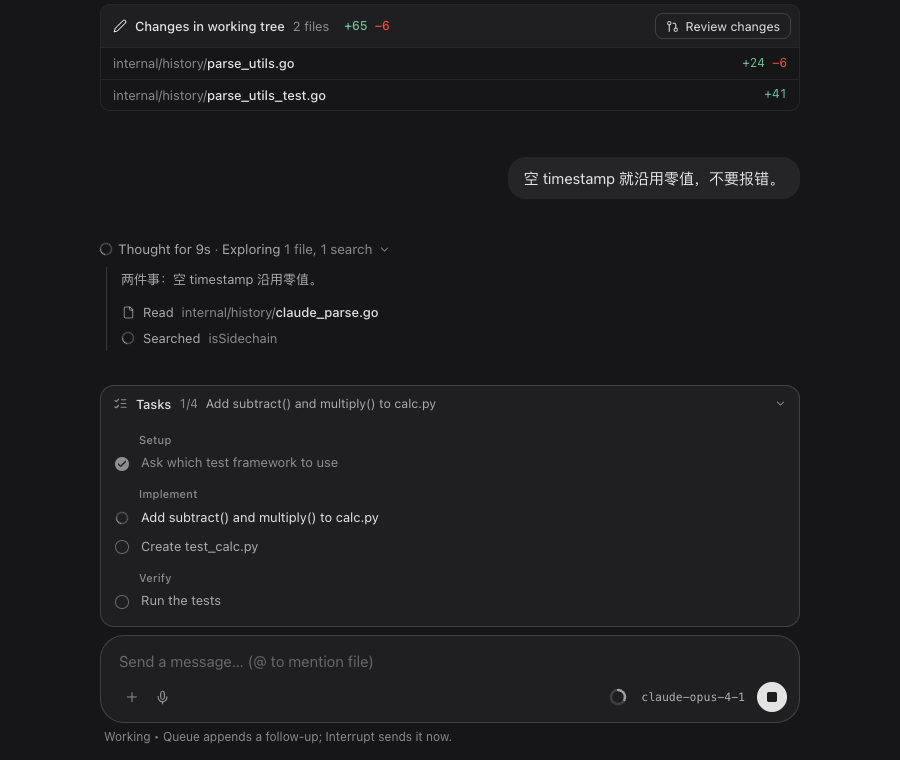
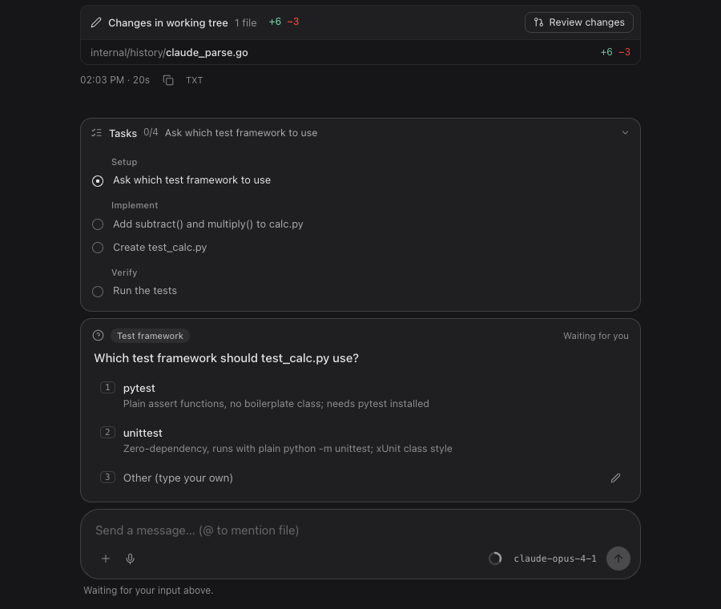
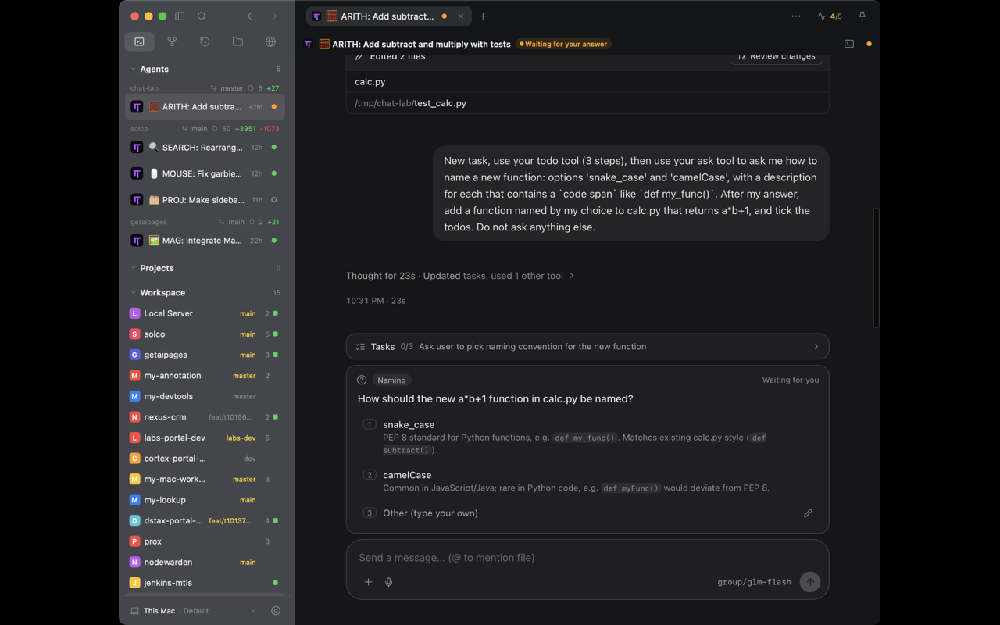
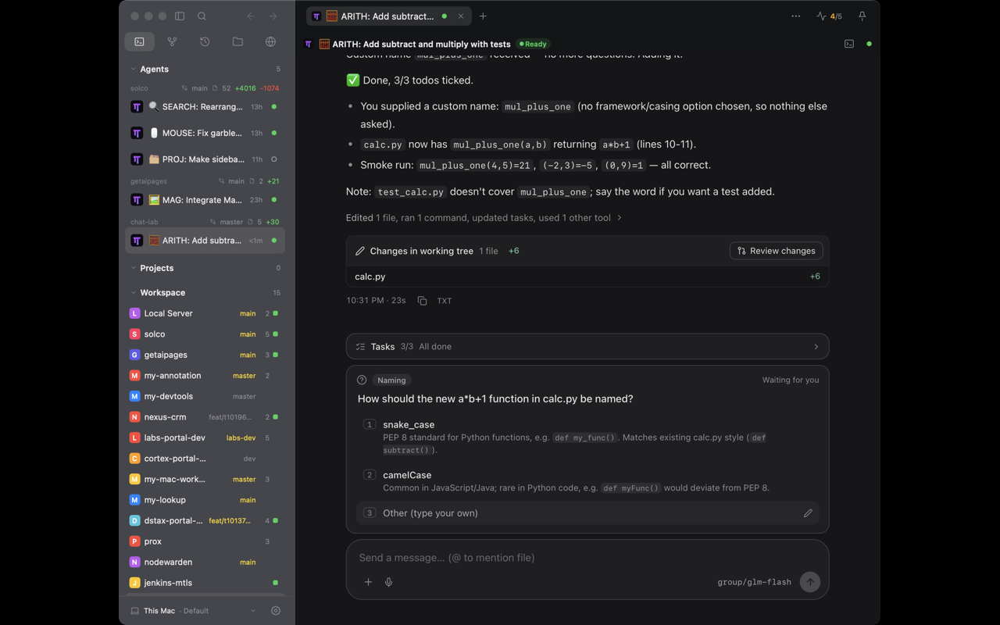
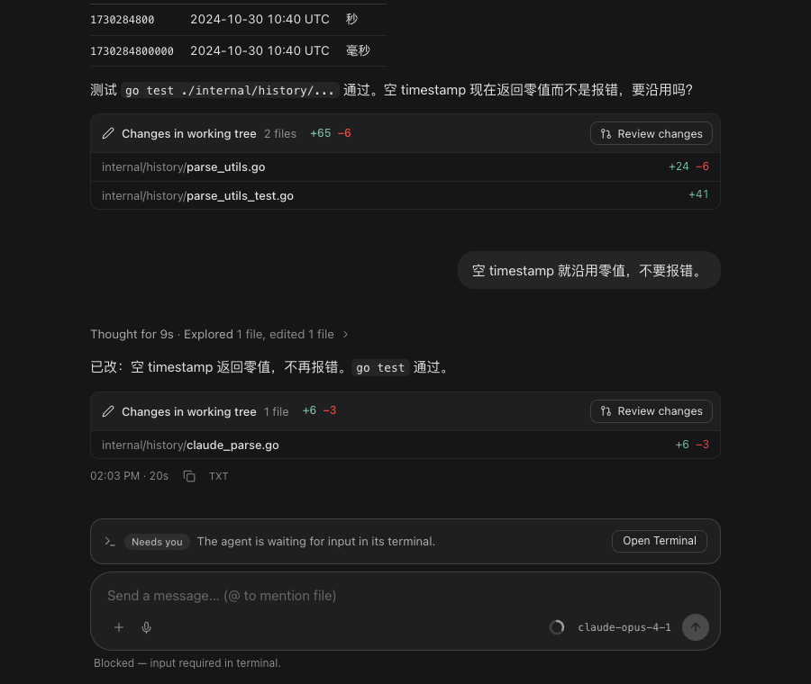
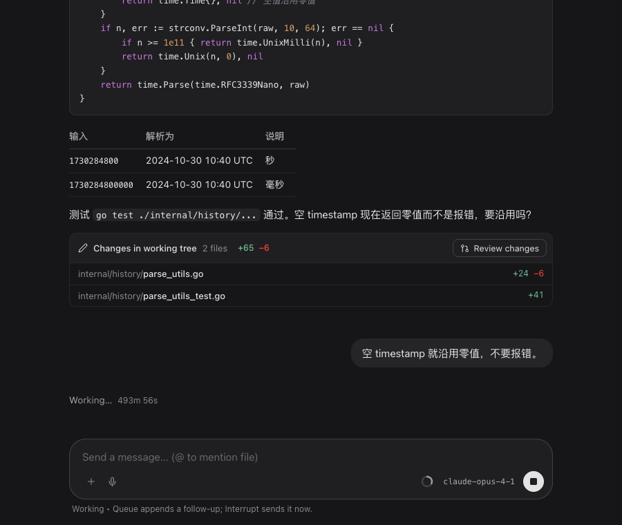
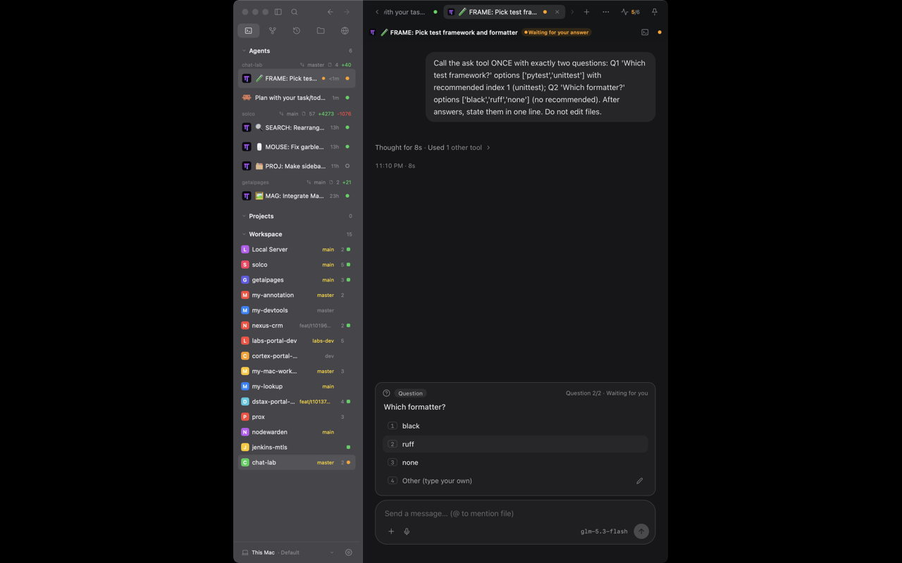
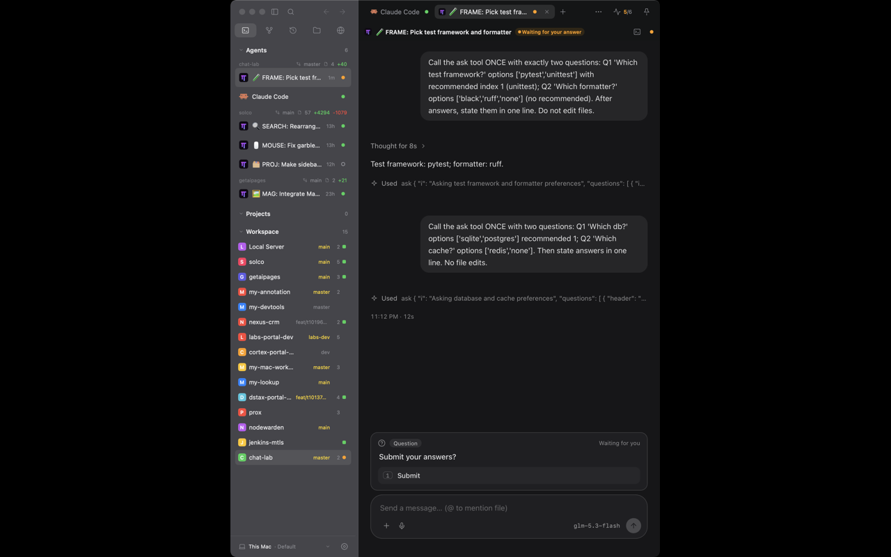
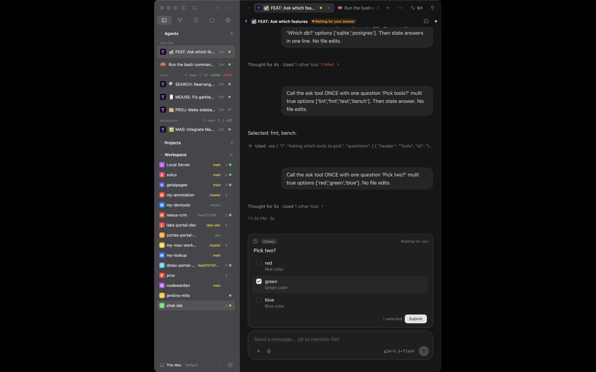

# Design Brief: Chat View（角色 · 过程 · 文字渲染）

> 工作流：`/think` + `/interactive-design-exploration`。预览：直接打开 `exploration.html`（`file://`，无服务器、无依赖）。
> URL hash 可预置状态：`#v=B&scene=live&theme=light&w=560`、`#v=A&font=serif&size=16&lh=1.8&ink=high`、`#v=A&scene=live&tick=44`（流式正文帧）。
> 冒烟：`agent-browser open file://$PWD/exploration.html && agent-browser eval "$(cat smoke.js)"` → `PASS 55 checks`。

## Decision

| 字段 | 内容 |
|------|------|
| **Status** | `Implemented 2026-10-30`（阶段 1–4 一并落地；真机 WKWebView 复核待做，见下）· 选型 2026-10-30 |
| **Chosen** | **A + B 组合**：A 的阅读体验与排版为底，借 B 的展开态类型化账本行与回合末改动卡；C 不做 |
| **用户气泡** | 中性 18px 大圆泡、右对齐（新增 `--r-bubble 18` 令牌） |
| **改动卡** | 做，且要 `+N −M`；**数据源（用户 2026-10-30 定）= 混合**：文件名取自该回合 edit 类工具路径，`+/−` 来自 `internal/gitworkbench`，仅「最新已结算回合 + 本地工作树」显示，标题 `Changes in working tree`；其余情况只列文件名 |
| **时长** | 带数字；同意给桥的 `ChatBridgeStep` 加时间戳（仅表现层投影，不动运行时） |
| **衬线体** | 做成设置项，默认无衬线（⇒ 需要 `settings` 新字段 + 桥状态字段，单列为阶段 4） |
| **占位符对比** | 接受 i4 低对比；「Increase contrast」开启时抬到 ≥4.5:1 |
| **实现授权** | 是：阶段 1、2、3、4 全部（2026-10-30） |
| **状态补充（阶段 5，用户 2026-10-30 授权并要求一次做完整）** | 等待 / 提问 / 任务清单 / 阻塞四种状态进设计并已实现，详见文末「Addendum · 状态」 |

---

## Problem

Chat 的「角色区分 + 过程呈现 + 文字渲染」该用哪套语言？锚点是 ChatGPT，但 Solco 的 Chat 是 **coding agent 的 Chat**——一个回合里 80% 的信息是读/搜/改/跑，不是对话。直接照搬 ChatGPT 会让过程无处安放，照搬 Codex/Cursor 又会失去阅读感。

---

## Phase 0 — 项目调研摘要

### 现状（读过的代码 + 实机取证）

| 项 | 发现 |
|----|------|
| 渲染入口 | `frontend/src/App.tsx`（React + `react-markdown` + `rehype-highlight`），宿主是 `/workspace` 的 `ui.WebView`；History 详情页只读复用同一页面（`readOnly`） |
| 数据 | `internal/nativeui/chat_bridge.go`：`ChatBridgeTurn{user,text,narration,thinking,tools,steps[kind=thinking\|text\|tool],live,failed,tsMs}`、`interactions`、`model`、`contextTokens`、`queuedText`、`outcome`。**step 没有时间戳/耗时；tool 的 input/output 是字符串** |
| 样式 | `frontend/src/chat.css` + `theme.css`：用户气泡 = `--accent` 蓝（`#0a84ff`）+ 不对称圆角；助手 = 带 `AGENT` 标签 + 描边的卡片；过程 = 三层 `details` 盒子；左边 3px `--working` 脉冲线 + `▍` 光标；正文 13px/1.5；标题 13px/600；`.md p` 是 `pre-wrap` |
| 与架构契约的差距 | `docs/client-product-architecture.md` §6（2026-09-06 ChatGPT process contract）要求：narration 永不折叠；thinking 每回合一块、标 Thought-for-Xs；工具是 chip 行，≥2 个连续调用自动折成可展开组；Working 指示防闪；失败回合留 Stopped 行；settled 回合有 footer（copy/time）。**WebView 版目前没做到这些**（只有 `WorkSummary` 计数摘要和 `details`），本次三套方案都按契约来 |
| 令牌 | `design_system.go`：Radius Control 6 / Row 8 / Card 10 / Pill 999；字号 Title 20 / Heading 16 / Body 12 / BodySmall 11 / Caption 10.5；无投影、hairline 边；`dockPanel`（Composer 的原生版：hairline 边、聚焦增亮 150ms） |
| 颜色 | `theme.css`：`--content #f5f5f7/#161618`、`--panel #fff/#1f1f22`、`--text #18181b/#f4f4f5`、`--text-muted #71717a/#98989f`；`highContrast` 设置要求次要文字 7:1、最淡 4.5:1（`appearance_test.go`） |
| 状态指示 | `status_indicator.go`：working = 转圈、idle = 空心环、其余 = 实心点（原型 C 的提示头状态槽沿用） |
| 相关决定 | 2026-10-11：Chat 走 `ui.WebView` + 单一 bound-service 桥，桥只做表现层；2026-10-29 shadcn 对齐（中性、不蓝）；2026-10-30 Agent surfaces（单一状态槽） |

### 参考取证（诚实标注来源）

| 参考 | 来源 | 可迁移的机制 |
|------|------|-------------|
| **Cursor Agent**（本次会话就在这个窗口里） | 本机截图实测 | 过程压成**一行灰字**：`Thought briefly`、`Exploring 7 files, 7 searches, 2 tools, ran 1 command`——**动词更亮、数量更暗**；当前步骤 `Thinking` 带扫光；用户消息是整宽圆角深色卡片，不是气泡 |
| **Codex 桌面版**（用户贴图） | 用户截图 | `已处理 2分钟 10秒` 细线分隔 + 折叠；底部「已编辑 6 个文件 +28 −5 · 撤销 / 查看变更」改动卡，路径 **目录淡、文件名亮**，`+` 绿 `−` 红右对齐；composer 是大圆角卡，右下一个实心圆形主按钮 |
| **ChatGPT 网页版** | 常识 / 本次**未现场核验**，数值为近似 | 助手无容器、无头像、全宽正文；用户是右对齐中性大圆角气泡（≈18px）；`Thought for Ns ›` 一行折叠；回复下方 hover 操作行；输入框大圆角卡 + 黑/白实心圆发送钮；正文墨色略低于纯黑白 |
| **Claude.ai** | 常识 / 未现场核验 | 助手正文用衬线体，用户无衬线；这是「文字气质」的唯一显著分叉，所以原型把 Serif 做成可切换而非默认 |
| Zed / Warp / Amp | 常识 / 未核验 | 块（block）式回合、粘性头、步骤时间线——原型 C 的来源 |

### 约束

- **必须保留**：桥只做表现层（不新增运行时语义）；Herdr 权威；narration 永不折叠；`interactions` 审批/提问 dock（含 1/2/3 键帽与自由文本答案）；Queue / Interrupt & send / Stop 三态；`@` 补全；听写；Context ring；model 胶囊；MD/TXT 复制；`Earlier messages`；`New messages ↓`；Stopped 行；`readOnly`（Sessions 详情，无 composer）；不记录/不记日志对话正文。
- **必须对齐**：中性色，accent 只给链接与焦点（用户气泡不再蓝）；无投影；hairline 边；`prefers-reduced-motion`；深浅两套；对比度不低于现有 `highContrast` 测试的 4.5:1 底线。
- **非目标**：不改终端/Diff/Git 原生面；不加 Notes/Bookmarks/Annotation；不改 Composer 的发送语义（Enter 发送、IME 不误发）；本次不引入新的 Markdown 引擎。
- **预计落点**：`frontend/src/theme.css`（墨色阶 + 圆角令牌）、`chat.css`（重写）、`App.tsx`（`TurnRow` / `StepChain` / `WorkSummary` / composer 结构）；若选 B 的改动卡，另需 `internal/nativeui/chat_bridge.go` 的小幅扩展（见 Handoff）。

---

## Options explored（单文件 `exploration.html`，右栏切换）

| ID | 名称 | 核心差异 | 优点 | 缺点 |
|----|------|----------|------|------|
| **A** | Prose（ChatGPT） | 助手**无容器**全宽正文（15px/1.72）；用户中性圆泡（18px）；每段过程折成**一行** `Thought for 14s · Explored 2 files, 1 search ›`，展开才见账本行；回复下 hover 操作行；Composer 24px 大圆角卡 + 单色圆形发送钮 | 阅读感最强、最像 ChatGPT；信息密度低、视觉最安静；落地只改 CSS + 少量 TSX | 过程只有一行摘要，审计一次改了什么要多点几下；A 引入两个不在令牌表里的圆角（bubble 18 / composer 24） |
| **B** | Work ledger（Codex / Cursor） | 用户整宽卡片（Card 10）；每段过程是**带总时长的分隔线** `Worked for 9s · 2 edits · 1 command ›`，展开为类型化账本（动词 · 路径[目录淡/文件名亮] · `+24 −6` / 耗时 / ✓）；回合末**改动卡**「Edited 2 files +65 −6 · Review changes」；运行中账本默认展开并扫光 | 审计性最好；改动卡直通 Solco 已有的 Diff Review；全部在现有圆角令牌内 | 竖向更高；改动卡的数据源是难点（见 Handoff）；与 ChatGPT 的距离最远 |
| **C** | Rail（监督长任务） | 每回合一个块：**粘性提示头**（状态槽 + 单行提示 + 时间）+ 左侧竖线时间线（思考=空心环、工具=图标、叙述=点、终稿=大白点）；右缘回合索引 | 长任务不迷路（滚到哪都知道在回应哪条指令）；状态与 Agent surfaces 的单一状态槽一致；最密 | 最「工具」、最不像聊天；纵向竖线占 26px；窄窗口更挤 |

### 交互状态（原型里全部可点）

| Scene | 触发 | 预期 |
|------|------|------|
| Settled | 默认 | 两回合完成；hover 出操作行；最后一回合操作行常显 |
| Live · working | Scenes → Live | 工具运行中：转圈 + 过程默认展开；Composer 发送钮变 Stop；键入后变 Queue + `Interrupt & send` |
| Replay stream | Scenes → Replay | 思考 → 工具 → 正文逐字，观察排版回流与末尾圆点 |
| Approval dock | Scenes → Approval | Composer 上方审批卡（1/2/3 键帽）；回合停在工具调用前 |
| Stopped | Scenes → Stopped，或 Live 里点 Stop | 保留已有内容 + `Stopped` 行 |
| Read-only | Scenes → Read-only | Sessions 详情：无 composer，无交互 |

### 文字渲染规范（Type lab 可实时对比；三方案共用）

| 层 | 规格 | 说明 |
|----|------|------|
| 字体 | `-apple-system → SF Pro Text → PingFang SC` | 与现状一致；**Serif**（`ui-serif`/New York + Songti SC）仅作可选，CJK 回退到宋体后粗体变弱（原型 `preview-a-serif.png`），不建议默认 |
| 正文 | A 15/1.72 · B 14/1.68 · C 13.5/1.62，字重 400 | 现状 13/1.5 对中文偏紧；CJK 行高 ≥1.65 |
| 字重 | 400 正文 · 500 文件名/表头 · 600 `strong` 与 `h4` · **不用 700** | CJK 700 过重；标题**不放大**（`h4` = 1em / 600），靠字重和间距分层 |
| 墨色（4 级） | i1 正文 · i2 过程动词 · i3 时间/对象/路径目录 · i4 占位符 | 同一份 ink 色用 α 区分，深浅主题各一套（下表） |
| 过程行 | 动词 i2、数量/对象 i3、文件名 i1/500、命令 mono 12.5px 带底 | 「动词亮、数量暗」「目录淡、文件名亮」来自 Cursor / Codex |
| 行内 code | `0.86em` mono，底 ink@7%，**无边框**，圆角 5 | 现状有 `1px` 感；去边框后行内更轻 |
| 代码块 | 圆角 10，底 ink@4% + hairline，顶部语言标签 + hover 才出现的复制钮 | 语法色沿用现有深色 hljs 配色并补浅色 |
| 表格 | 只留横线，无竖线；表头 i2/500；数字 `tabular-nums` | ChatGPT 式 |
| 数字 | 时间、耗时、`+/−` 一律 `font-variant-numeric: tabular-nums` | 防抖 |
| CJK / 拉丁间距 | `text-autospace: ideograph-alpha ideograph-numeric` | **需在 WKWebView 实测**（Safari 18.4+；本机 macOS 15.6 应支持）；不支持时静默无效，不破坏排版 |
| 平滑 | `-webkit-font-smoothing: antialiased`（现状已有） | 深色下避免字体发胀；差异细微，Type lab 可对比 |
| 流式 | 末尾一个小圆点（A/B/C），当前步骤标签扫光；**去掉**左边 3px 脉冲线与 `▍` | 位移少、不抖 |

**墨色阶与对比度**（按 α 混合后对 `--content` / `--panel` 实算；脚本 `node` 一次性计算，原型右栏同步显示）：

| 主题 / 档位 | i1 | i2 | i3 | i4（占位符，非必要文字） |
|-------------|----|----|----|--------------------------|
| dark · **std** | α.92 → 14.0 | α.66 → 7.7 | α.52 → 5.2 | α.34 → 2.9 |
| dark · soft | α.84 → 11.8 | α.60 → 6.5 | α.50 → 4.9 | α.32 → 2.8 |
| dark · high | α1 → 16.4 | α.78 → 10.3 | α.64 → 7.3 | α.42 → 3.8 |
| light · **std** | α.90 → 12.4 | α.70 → 6.3 | α.60 → 4.5 | α.38 → 2.4 |
| light · soft | α.80 → 8.9 | α.64 → 5.3 | α.60 → 4.5 | α.34 → 2.1 |
| light · high | α1 → 16.3 | α.80 → 8.9 | α.70 → 6.3 | α.46 → 3.0 |

> i1–i3 全部 ≥4.5:1；i4 只给占位符与装饰，**低于 4.5**——占位符低对比是 ChatGPT 式惯例，但与 Solco 的 `highContrast` 底线有张力：实现时 `highContrast` 下把 i4 抬到 ≥4.5。

---

## 推荐与理由

**A 为底 + B 的两件东西**：

1. 用户明确倾向 ChatGPT，A 的阅读体验、正文排版、Composer 都直接对标；
2. coding agent 缺的是「看一眼就知道改了什么」，所以借 B 的**改动卡**（回合末）和**展开态账本行**（点开 A 的那一行后看到的就是 B 的行格式——A 与 B 在展开态是同一套行）；
3. C 的粘性提示头 + 回合索引与「Chat 与 Terminal 并列」的定位不冲突，但价值只在长任务；等 A+B 落地后用真实长会话再判断。

**最脆弱的假设**：改动卡需要每个文件的 `+N −M`。`ChatBridgeTool.input/output` 只是字符串，且各 Provider 的 Edit/Write 输入形状不同。若从 transcript 解析，Provider 一变就静默失效；若改用 `internal/gitworkbench`（工作树 diff）则不是「这个回合改了什么」而是「现在工作树有什么」。→ 首期改动卡**只列文件名**（无 `+/−`）也成立；`+/−` 作为独立后续，数据源待你决定。

---

## Preview

| 文件 | 看什么 |
|------|--------|
| `exploration.html` | 右栏切 Variants / Scenes / Canvas（主题、宽度 560/760/1040、Spec overlay：悬停显示真实 font-size/行高/字重/墨色 α）/ Type lab（字体、字号、行距、字重、墨色档、CJK 间距、平滑）+ 实时对比度读数 |
| `smoke.js` | 55 项断言：三方案 × 五场景渲染、审批 dock、展开/收起、改动卡、回合索引、Stop↔Queue、主题/字号/墨色/autospace/宽度、对比度、Replay |

### 截图

| 状态 | 文件 |
|------|------|
| A · 已完成（深） | `preview-a-settled.png` |
| A · 进行中（工具运行） | `preview-a-live.png` |
| A · 流式正文 | `preview-a-stream.png` |
| A · 审批 | `preview-a-ask.png` |
| A · 浅色 / 衬线 16/1.8 / 只读 | `preview-a-light.png` · `preview-a-serif.png` · `preview-a-readonly.png` |
| B · 已完成 / 改动卡 / 进行中 | `preview-b-settled.png` · `preview-b-changes.png` · `preview-b-live.png` |
| B · 窄窗（560，浅） | `preview-b-narrow-light.png` |
| C · 已完成 / 进行中 / 审批 / 窄窗 Stopped | `preview-c-settled.png` · `preview-c-live.png` · `preview-c-ask.png` · `preview-c-narrow-stopped.png` |
| 全屏（含右栏） | `preview-panel.png` |

---

## 需要你拍板（未定稿前不实现）

> 2026-10-30 已答：1、2、4、5、6（见 Decision）。**数据源与实现授权亦已答（见 Decision）。**

1. **方案**：A / B / C，或推荐的 **A+B 组合**。
2. **用户气泡**：A 的 18px 中性大圆泡（引入 `--r-bubble 18`）还是 B 的整宽卡片（Card 10，不引入新令牌）？
3. **改动卡**（B）：做不做？做的话首期只列文件名，还是要 `+N −M`（需要定数据源，见「最脆弱的假设」）？「Review changes」要打开 Diff Review，需要桥里加一个只切换 `WorkspacePrimarySurface` 的动作——算表现层，但请你确认。
4. **`Thought for Xs` / `Worked for Xs`**：需要桥给 step 加时间戳（`ChatBridgeStep.TsMS`）。同意加就带时长；不加就退化成 `Thought` / `Worked`（无数字）。
5. **衬线体**：只在原型里保留对比，不进产品（推荐），还是做成设置项？
6. **占位符对比**：接受 i4 低于 4.5（`highContrast` 下抬高），还是占位符也守 4.5？

---

## Success criteria（定稿前）

- [x] 原型内可切换全部方案 / 状态（`smoke.js` 55/55）
- [x] 默认可在 `file://` 下打开（headless Chromium 实测，无控制台错误）
- [x] 视觉与项目 token 对齐：色值取自 `theme.css`；圆角取 `Radius()`（A 的 18/24 与 B 的 Composer 14 已在上表标为新增/待并入）；无投影；hairline 边；中性色
- [x] 机制与实现一致：数据形状对应 `ChatBridgeTurn`；契约里的 narration 不折叠 / 分组 / Stopped / 防闪
- [ ] 用户已在 `interactive_feedback` 中选定方案
- [ ] Decision 表已更新

---

## Implementation handoff（Phase 4，定稿后；三阶段，每阶段独立可合并）

**阶段 1 · 文字与表面（纯 CSS + 少量 TSX，无桥改动）**
- `theme.css`：加 ink 四级（深浅各一套，`highContrast` 下抬 i4）与圆角令牌（沿用 Card 10 / Row 8；A 的 bubble/composer 令牌按拍板结果）；删掉用户气泡对 `--accent` 的依赖。
- `chat.css` / `App.tsx`：用户气泡中性化；助手去掉卡片与 `AGENT` 标签；正文字号/行高/字重、表格、行内 code、代码块头；去掉 `.live` 左边框与 `▍`，换末尾圆点；footer 改 hover 操作行；Composer 皮肤（圆角卡、单色圆形发送/Stop/Queue 钮）。
- 保持：所有现有行为与键盘契约；`readOnly`。

**阶段 2 · 过程（TSX）**
- `StepChain` / `WorkSummary` 改为：每个「思考+工具」连续段一条摘要线（≥2 个调用折叠；单个调用直接是一行）；展开为账本行（动词 · 路径 · 结果）；运行中默认展开，结算后折叠；Working 延迟 ≥250 ms 才显示（防闪）。
- 摘要文案：`Explored N files, M searches` / `Edited N files` / `Ran N commands`（动词 i2、其余 i3）。

**阶段 3 · 时长与改动卡（需桥改动；已获方向性同意）**
- `ChatBridgeStep` 加 `TsMS`（Go 侧 `chat_bridge.go` 投影，不动运行时）；`Thought for Xs` / `Worked for Xs` 取相邻 step 时间差；缺时间戳时退化为不带数字。
- 改动卡：文件列表来自该回合 `edit` 类工具的路径；`+N −M` 的数据源**待用户定**（见「需要你拍板」更新）；「Review changes」= 一个只切 `WorkspacePrimarySurface` 到 Diff Review 的桥动作。

**阶段 4 · 衬线体设置项**
- `internal/settings` 新增 General 外观字段（默认无衬线）+ Settings → General → Appearance 一行；`ChatBridgeState` 带出该字段，页面据此设 `--ff-prose`。注意 CJK 回退到宋体后粗体变弱，仅作可选。

**验证命令**
```sh
cd frontend && bun run typecheck && bun run build
GOTOOLCHAIN=auto go test ./internal/nativeui/...      # chat_* 回归
GOTOOLCHAIN=auto go tool mygo vet .
GOTOOLCHAIN=auto go tool mygo build                    # 打包并在真机 WKWebView 里看
git diff --check
```

**浏览器 / 真机检查步骤**
1. 在真实 App 的 WKWebView 中确认 `text-autospace`、`ui-monospace`、`-webkit-font-smoothing` 的实际效果（原型在 Chromium 里验证，**不等于** WKWebView）。
2. 深/浅主题 × 窗口宽 560/760/1040 各走一遍 Settled / Live / Approval / Stopped / Read-only；设置里开 Increase contrast 复查 i3/i4。
3. 打开一个真实长会话（>200 回合）确认 `Earlier messages`、`New messages ↓`、粘住底部、IME 中文输入 Enter 不误发。
4. 与原型对照：气泡色是否中性、过程是否一行摘要、正文是否 ≥1.65 行高。

**与原型的已知差异**：原型的 Markdown 是手写 HTML，真实页面走 `react-markdown`，需确认 `h4` 以外的标题层级（h1–h3）也落在同一字号规则；Replay 的时序是演示用，不代表真实 Provider 节奏。


---

## Addendum · 状态（阶段 5：等待 · Ask user question · Tasks · 阻塞）

> 流程说明：用户在反馈里明确要求「在这一次实现里完成」并「也加进设计里面去」，所以这四个状态**先于独立原型落地**，设计证据取自真实页面（`frontend/` 的 mock 预览 + 真机 WKWebView），而不是另做一份 `exploration.html`。这是对 interactive-design-exploration「先原型后实现」的一次有记录的例外。

**四个状态与它们的位置（都在消息流下方、Composer 上方的一条 dock 栈里）**

| 状态 | 触发 | 表现 | 数据源 |
|---|---|---|---|
| Tasks | 回合里出现任务清单类工具 | 折叠行 `Tasks 2/4 · 当前项`；展开按 Phase 分组；全部完成显示 `All done` 并在下一回合开始时退场；有提问时压成一行（compact） | Claude `TodoWrite`、Codex `update_plan`、omp `todo`（解析工具结果文本）——全部只读自 transcript，`ConversationToolCall.Input` 现在带完整入参 |
| Question | agent 被阻塞在一个提问上 | 问题 + 编号选项（描述里的 `` `code` `` 渲染成行内代码）；`Other / Type something / Chat about` 变成输入框；回答失败不静默——卡片回来并显示 `Answer not delivered: …` | Claude：屏幕抓取（原有）；omp：transcript 中未返回的 `ask` 调用（≥2 选项；多问题按 `Question 1/2 · Waiting for you` 逐题出卡，`recommended` 决定起始高亮）；收尾的 `Review answers` 表单与 Claude 的 `Ready to submit your answers?` 都作为一张卡（Submit / Cancel） |
| Blocked | 阻塞但没有可结构化的提问 | 一条 `Needs you · The agent is waiting for input in its terminal.` + `Open Terminal`（本地切 surface） | agent 状态 |
| Working | 助手回合进行中 | 末尾圆点 + 经过时间（<1h 才显示，防过期时间戳） | 回合起始时间戳 |

头部状态芯片：有待答问题时读 `Waiting for your answer`，不再是 `Blocked — use the terminal`。

**投递（真机排查的发现）**：omp 经 bun 启动，Herdr 的前台进程是 `bun.native`，`agent.send_keys` / `agent.prompt` 以「not an active named agent / no longer the pane foreground process」拒绝。处理在 Herdr 边界（`internal/herdr/launch_transport.go`）：**仅这两种身份拒绝**回落到 schema 里已有的 pane 级 `pane.send_keys` / `pane.send_input`；忙碌/未就绪的拒绝绝不绕过。输入框回答（omp 的 Custom answer 编辑器本身就是阻塞状态，`agent.prompt` 按设计拒绝）用 `pane.send_input` 直接打进该编辑器。

**证据**

| mock（`/tmp` 预览页，同一份 React/CSS） | 真机 WKWebView |
|---|---|
|   |   |
|   | 真机走通：omp + GLM flash → 计划 → `ask` → 点选/自填 → 编辑 → 测试 → 改动卡 + `All done` |

**第二轮（多问题 · 页内等待态 · Claude 实测）**

- 多问题 omp `ask`：每题一张卡，`Step/Steps` 进度；方向键以 `recommended` 起始行为基准（`PendingInteraction.Start`）；每题的 Other 都可自填。答完最后一题后终端停在 omp 新版的 `Review answers` 表单，屏幕识别（`ompReviewSheet`）再出一张 `Submit your answers?` 卡。
- Claude Code 多问题 AskUserQuestion 是分页 TUI（题目页 → Submit 页）：答题后状态仍是 blocked，没有任何状态边沿可触发再检测，所以每次屏幕识别型回答之后 1.5 s 补一次 `redetectAfterAnswer`，下一题 / `Ready to submit your answers?` 自动出卡。
- 「未绑定 / 加载中」两个原生横幅搬进页面（`SessionState`，`Open Terminal` 与 dock 同一张脸）；只有页面不存在时才回落原生横幅。
- **真机排障（Claude 一直停在 `Waiting for agent session…`）有三个根因**：① Herdr 的 `agent list` 对 Claude 不带 `agent_session`，hook 上报的会话身份在下一次 projection 刷新时被抹掉（现在由 `hookIdentities` 记住并在 `applyProjection` 后补回，同一 provider 才补）；② 「无来源」闩锁只认 `card.ConversationID`（实际恒空），身份出现后也不放行（现在认 agent 会话身份）；③ 目录扫描的 `cancel` 守卫完成后不清，之后所有扫描被拒（`history_state.go` 修复；会话事件仅在 pane 身份变化时踢扫描）。
- 证据图：   
- 证据：omp + GLM flash 两题 `ask`（postgres(推荐起点) + 自填 `memcached`）→ Submit 卡 → 终端收到 `DB: postgres; cache: memcached.`；Claude + GLM flash 两题（Go / Apache-2.0）→ Submit 卡 → `你选了：Go + Apache-2.0`。
- 配置事实：此 Claude Code 环境没有任务工具（`ToolSearch` 找不到 `TaskCreate/TaskUpdate`/`TodoWrite`），Tasks 托盘无法在 Claude 上真机复测，只有单元测试覆盖 `TodoWrite` 解析。

**第三轮（用户确认全做的四项）**

- **Review 卡的 Cancel**：`PendingInteraction.EscapeOption`——omp 的 `Review answers` 只有 Submit 一行，取消是 `⎋`；选 Cancel 发送 Esc（真机：`Ask tool was cancelled by the user`）。Claude 的 `Submit answers / Cancel` 是真实编号行，仍走方向键。
- **hook 会话身份持久化**：`Session.HookSessions`（`<instance>/<pane>` → agent/kind/source/value/terminal_id，不含对话内容）。恢复后在每次 projection 应用时补回，要求同 provider 且同 terminal，pane 已不在 projection 里的条目保存时丢弃。真机：重启 Solco 后 Claude 的 Chat 立即绑定，无需新的 hook 事件。
- **Claude `TaskCreate/TaskUpdate`**：整窗重放（create 追加 pending，id 取结果文本里的 `#N`，否则按序号；update 改状态/标题，`deleted` 移除；结果以 `Error`/`not found` 开头的调用跳过），与整表写入者（TodoWrite 等）取较新者。**未经真机转录验证**：实验用 Claude 环境没有任务工具，格式依文档约定，只有单元测试覆盖；遇到真实转录出入时以转录为准修正。
- **omp 多选 `ask`**：`PendingInteraction.Multi` + `ResolveSetCAS`（每个勾选项都必须是 provider 自己的选项，空集合允许，首个赢家 CAS）；页面是复选框 + `Submit`，桥接 `AnswerInteractionMulti`；按键 = 从首行起逐行 `down`，勾选行 `space`，最后 `enter`。真机：`fmt, bench` 非连续勾选；多选 + 单选混合的两题 ask 逐题推进。多选无 Other 行；带 `recommended`（预勾选语义未验证）的多选仍回落 Blocked。

**已知边界**：箭头导航假定选项高亮在第一项或 `recommended`（终端里被手动挪过会偏）；多选带 `recommended` 仍回落 Blocked；Claude `TaskCreate/TaskUpdate` 未经真机转录验证；持久化的 hook 身份在 Solco 关闭期间 Claude 被换成新会话时，会在下一次 hook 事件前短暂指向旧会话；Review/Submit 卡之外的 omp 表单（如 note）不结构化。

---

## Addendum 2 · 新会话空态 · 回复/工具顺序 · 工具运行 Loading（2026-10-31，已实现）

> 流程：`/think` + `/interactive-design-exploration`。原型在 `exploration.html` 右栏 Scenes 的 ①②③ 三项与 Addendum 2 变体控件（hash：`#scene=fresh|freshsent|order|running&fresh=F1|F2&ready=ready|starting&order=before|after&load=L1|L2|L3`）。冒烟 `smoke.js` 现为 **67 项**。**已按 Decision 实现（三阶段一次做完）。**

### Phase 0 · 调研（读过的代码）与根因

| # | 现象 | 根因（有代码证据） |
|---|------|--------------------|
| ① | 刚启动 Agent 切到 Chat，一直「Waiting for agent session…」 | `App.tsx`：`state.waiting` 时整个 composer 被藏（`readOnly \|\| state?.waiting ? null`），只剩 `Open Terminal`；`workspace.go rebindWorkspaceChat` 还弹一条 toast「No chat stream available…use Terminal」。但 Claude/omp 在**收到第一条 prompt 之前不会写转录文件**——这个状态在用户输入前永远不会结束。发送路径本身没问题：`sendChatText` 只要求 `chatPaneID`（waiting 态已设）和 `SentNow` |
| ① 续 | 发送后没有回显 | `chatAfterPrompt` 只在 `chatLivePump != nil`（已绑定实时尾）时建 pending echo，waiting 态没有 pump，所以用户发出的话会消失，页面仍写「waiting」 |
| ② | 回复挤一起、工具挤一起 | **数据在解析层就丢了顺序**：`internal/history/pi.go` 把连续 assistant 消息（中间只隔 toolResult）合并成一条——`Text += "\n\n"+text`、`Thinking` 同理、`ToolCalls` 另成数组；一条消息内 `[text, toolCall, text, toolCall]` 也被 `piBlocksText/Tools` 拆成两个桶。`DeriveTimeline` 之后只能出「思考 → 全部文字 → 全部工具」。前端 `segments()` 本来就按序渲染，没问题。Claude 按 msgID 切、Codex 按 response_item 切，天然有序，不受影响 |
| ③ | 第 3 个「Explored …」没有动态 | `TimelineTurn.Live` 只在 `decoder.PendingTail() != nil` 时置位，而只有 **Claude** 实现了 `pendingTail`；omp/Codex 的回合永远不是 live → 没转圈、没 shimmer、没 Working 线，一条过去时的摘要停在那里。另有三处叠加：`isRunning = !toolOutput` 把「空输出」和「没返回」混为一谈（pi 空结果不写 Output）；`runIsActive` 只看最后一步（并行工具会误判）；pi 合并后各步共用一个时间戳，「Thought for Ns」算不出来 |

### 设计方案

**① 新会话空态**（`Scenes → ① Fresh agent`，`② Fresh · sent` 播放整条链）

| ID | 形态 | 适用 |
|----|------|------|
| **F1 Invitation（推荐）** | 居中一块：图标 + `Start the conversation` + 一句「Claude Code is ready. **Type a prompt below** and Solco sends it to the agent…」+ 3 个示例 chip（点一下填进输入框）+ 次要的 `Open Terminal`；composer 常亮聚焦，placeholder `Tell Claude Code what to do…`，提示行 `⏎ sends it to the agent` | 用户第一次看到 Chat，需要被告知「这里就能直接用」 |
| F2 Quiet | 日志区只有一行灰字 `No conversation yet — type below to start one.` | 极简、不教育；重复进入多次的老用户 |

- 共同点：composer 打开；Enter = 发给 Agent；发送后**立刻**出用户气泡（pending echo）+ `Working…`，会话一出现就由真实转录接管（echo 按文本对账后消失，不重复）。
- Agent 还在启动（Herdr 阶段非 idle）：`Ready/Starting` 开关演示——允许打字，Send 锁住，提示 `The agent is still starting — you can type now; Send unlocks when it is ready.`
- 空态不显示 context ring / 模型胶囊（没有可显示的事实），也不显示 `Earlier messages`。
- 删除 `use Terminal` toast（它和新引导矛盾）。

**② 回复 / 工具顺序**（`Scenes → ② Reply / tool order`，`Before / After` 对比）：修复在数据层——给 `TranscriptMessage` 加一条**保序的 `Parts`**（`text | thinking | tool(索引)` + 每块自己的时间戳），pi 解析器按块顺序追加；`DeriveTimeline` 有 `Parts` 就按它出 step，没有就走旧路径（Claude/Codex/旧数据不变）。页面零改动：`回复 → 聚合 → 回复 → 聚合` 自然出现。无新桥方法、无新 Herdr 调用。

**③ 工具运行 Loading**（`Scenes → ③ Tool run loading`，三种表达）

| ID | 表达 | 评价 |
|----|------|------|
| **L1 Shimmer（推荐）** | 行首转圈 + 现在时动词带扫光（`Exploring 4 files, 2 searches`），展开体里正在跑的那行也转圈 | 与现有 `Thinking…` 同一套语言，零新元素 |
| L2 Elapsed | L1 的转圈 + 摘要后与运行行上的计时（`12s`） | 长任务（`go test`、大搜索）一眼看出「卡了多久」，但多一个会跳的数字 |
| L3 Bar | 摘要下方 2px 不定进度条 | 最醒目；但是新视觉元素，与「只用一个状态槽」的原则有张力 |

实现要点（与方案无关）：① 让最后一个助手回合在 Agent `working`（Stop 键同一信号 `disposition==queue`）时视为 live——omp/Codex 也有转圈和 Working 线；② 桥给 step 加 `toolDone`（输出非 nil 即完成），空输出的工具不再「永远在跑」；③ 运行判定改为「run 里存在未完成工具」；④ step 时间戳逐块（②的 `Parts` 顺带解决）。

### 我顺手发现的其他细节（建议一并修）

1. **「已绑定但 0 回合」**：`turns.length === 0` 现在写 `No conversation yet.` 且没有任何出路——并入 ① 的空态。
2. **pi 的「Thought for Ns」**：合并后各步共用首条时间戳，时长永远缺失（②的 `Parts` 带逐块时间戳）。
3. **空输出工具永远转圈**：见上，`toolDone` 修。
4. **并行工具**：多个工具同时在跑，只看最后一个会让摘要提前变过去时。
5. **回合收尾闪烁**：把 live 判定接到 Agent 状态后，要保证 working→ready 的边沿上改动卡/页脚才出现（现有 `Foot`/`ChangesCard` 本来就只在 `!turn.live` 出）。
6. （仅提示，不改）Codex 的 `reasoning` 在「上一条是带文字的 assistant」时另起空宿主，顺序仍正确，无需改动。

### Decision（2026-10-31，用户已答并授权一次做完）

**Chosen**：① **F1 Invitation**——且用户强调：空态下 composer 可直接发消息，由 Solco 经 Herdr API（`agent.prompt`，即 `sendChatText` 既有路径）替用户触发第一条消息；② `Parts` 保序；③ **L1 Shimmer**；waiting 态发送后**立刻**显示用户气泡 + Working（pending echo）；「其他细节」1–5 **全做**；实现授权：三阶段一次做完。

### 需要你拍板（已答，保留原题）

1. ① 空态：**F1 Invitation** 还是 F2 Quiet？
2. ③ Loading：**L1 Shimmer** / L2 Elapsed / L3 Bar？（L1 可叠加 L2 的计时，只在 >8s 才出现，要不要？）
3. ① 的 pending echo：waiting 态发送后立刻显示用户气泡（推荐），还是只清空输入框等会话出现？
4. 上面「其他细节」1–5 是否一起做？

### Implementation handoff（定稿后）

| 阶段 | 内容 | 落点 | 可独立合并 |
|------|------|------|-----------|
| 1 · 顺序 | `Parts` 模型 + pi 保序 + timeline 消费 | `internal/history/models.go,pi.go,live.go`（deepCopy/equality）· `internal/conversation/models.go,transcript.go,timeline.go` | 是（页面无改动） |
| 2 · Loading | working→live；`toolDone`；some-running；（L2/L3 视选型） | `chat_bridge.go`（step 字段）· `frontend/src/turn.tsx,App.tsx,mygo.ts,chat.css` | 是 |
| 3 · 空态 | waiting 态开放 composer；pending echo 无 pump 时也建；空态组件；去 toast | `App.tsx,dock.tsx,chat.css` · `chat_ui.go chatAfterPrompt` · `workspace.go` · `chat_bridge.go`（Waiting 在有 echo 时为 false） | 是 |

**验证**：`GOTOOLCHAIN=auto go test ./internal/history/... ./internal/conversation/... ./internal/nativeui/...` + `cd frontend && bun run typecheck && bun run build` + `go tool mygo vet .` + `git diff --check`；新增回归——pi 夹具 `[text, tool, text, tool]` 得到 `narration/tool/narration/tool` 四个 step 且时间戳逐块；空输出工具 `toolDone=true`；waiting 态 `sendChatText` 建 echo 且 `Waiting=false`；echo 在转录出现后被消费。真机：omp 起一个新 pane → Chat → 输入 → 看气泡/Working/会话接管；长回合看交错顺序与第 N 个 Explored 行的转圈。

**最脆弱的假设**：「`disposition == queue` ⇔ Agent 正在这个回合里工作」。若某 Agent 在没有写转录的阶段（压缩上下文、自行等待）也报 working，末尾助手回合会短暂显示 Working 线——可接受（它确实在忙），但不应把已结算的上一回合的改动卡藏起来超过 working 持续时间。


### 真机验证（2026-10-31，Solco 0.10.0 已安装版，lab 窗格 `/tmp/chat-lab`）

| 项 | 结果 |
|---|---|
| 新 Claude 窗格切到 Chat | ✅ 显示 `Start the conversation` 邀请 + 3 个 chip，composer 常亮 |
| 键盘：`/` → ↑↓ → Tab → Enter（系统级按键，非 AX 写值） | ✅ 列表出现、选择、Tab 接受（`/model`）；清空后输入 + ⏎ 发送 |
| 首条 prompt（走 `agent.prompt`） | ✅ 立刻出用户气泡 + `Working…`；会话出现后气泡不重复，回复 `ready` 接管 |
| 回归：邀请态 `/` 不弹列表 | ❌→✅ 根因：目录只在 `conversationId` 非空时加载，空态没有 id；改为 `conversationId \|\| provider` 即加载；并保护「从空态到首个会话 id」那一跳不清掉已键入的草稿 |

**发送形态与各 Agent 的实际接收（`herdr agent prompt` = Solco 的 `agent.prompt`，读各家转录取证）**

| Agent | `@/abs/img.png` | Skill 调用 | 备注 |
|---|---|---|---|
| Claude Code | ✅ 转录出现 `attachment{type:file, content.type:image, base64}`，模型答 red（原生当图片读） | `/name args` ✅ 被当 skill（`The user invoked /name`） | |
| Codex | ✅ 文本里保留路径，模型自行调 `view_image`（答 Red）；非 TUI 原生图片附件 | `$name args` ✅ 转录出现 `{type:"skill"}` + 注入的 `<skill>` 消息 | `<skill>` 注入行是元数据，非用户话 |
| pi | ✅ 模型自行 `read`（返回 image 块，答「红色」） | `/skill:name args` ✅ TUI 显示 `[skill] name` | |
| omp | Herdr 拒绝 `agent.prompt`（`no longer the pane foreground process`，bun 启动）→ Solco 既有回退 `pane.send_input` | 同上回退 | 本轮未再复测 |

结论：Solco 发出的永远是文本（`@绝对路径` / `/name` / `$name` / `/skill:name`）；Claude 把路径当原生图片附件，Codex/pi 靠模型的读图工具，三家都读到了正确的图片内容。已知局限：Codex/pi 的图片读取依赖模型工具，非 TUI 原生附件；若 Agent 没有读图能力则只会看到路径文本。

**邀请态的已知边界**：Agent 已经有会话但 Herdr/hook 没报告会话身份（lab-codex 的 hook 退出码 127）时，Chat 仍显示邀请——与旧版「Waiting…」同一根因（`chatSourcelessPaneID`），文案改为「as soon as the agent reports its session」；`Open Terminal` 仍是出路。


## Decision 2026-10-31 · 下一阶段（0.11.0，三阶段同批落地，presentation only）

**阶段 1 · 投递可信 + 语音收尾 + 键盘**
- 发送走页面级 `Outbox`：用户气泡下的状态行 `Sending… → Sent`（`state.echoPending`）→ 失败时 `Not delivered` + Retry / Edit / Discard；「投递结果不确定」永远不提供 Retry（避免重复发给 Agent）。
- 语音：转写失败保留录音（`failedClipRef`）可 Retry；麦克风系统授权等待（700 ms 后显示 `Waiting for microphone permission…`）与拒绝（`Open System Settings`，bridge `OpenMicrophoneSettings`）有明确状态。
- 键盘：空输入 ↑/↓ 召回历史 prompt、⌘. 中断、⇧⌘M 语音、⌘↑/⌘↓ 上/下一条消息；全部写入 Keyboard Shortcuts 表。

**阶段 2 · 会话绑定自愈**：Agent 没上报会话身份（hook 缺失/退出码 127）时邀请态不再无路可走：列出同 provider + 同 cwd + 24 h 内未归档的最近会话，用户**显式点选**才绑定（文案声明“可能不是这个 Agent 的”）；之后测得真实身份即自动让位。永不自动绑定，不写 History，不新增 Herdr 方法。

**阶段 3 · 长对话导航**：「New messages ↓」胶囊带未读条数（>1 时 `N new messages ↓`）；⌘F 对话内查找（WebKit `window.find`，⏎/⇧⏎ 上下一个，Esc 关闭并还焦点给 composer）；最近 24 条之外的 turn 用 `content-visibility:auto` 跳过布局与绘制（不做虚拟列表，不改 DOM 顺序，TOC/锚点不受影响）。

**验证**：`go test ./...`（含新增 `chat_link_test.go`：候选只含近期未归档同 provider 会话；未提供的 key 不绑定；绑定后实测身份到来即让位）· `go tool mygo vet .` · `cd frontend && npx tsc --noEmit && npx vite build` · `git diff --check`。真机（0.10.0 安装版，stable 签名）：⌘F 弹出查找条并聚焦、命中高亮、Esc 关闭且焦点回 composer；其余阶段 1/2 的页面态以单测与类型检查为准——真机未向他人 Agent 发消息，未复测 Retry/邀请链接行。
**最脆弱的假设**：`content-visibility:auto` 的 `contain-intrinsic-size` 估值与真实高度差大时滚动条会有轻微跳动；若出现，缩小 `RECENT_TURNS` 之外的范围或改成虚拟列表。


## Decision 2026-10-31 · 入口一致性与首帧稳定（0.11.1，presentation only）

用户要求：新会话、从已有 Agent 窗格切入、从历史记录切入，Chat 的显示必须一致。实测与代码对照后的结论与修复：

| 项 | 结论 |
|---|---|
| 内容 | **一致**。live 增量解码与整文件解析的投影逐字段相同（`history/live_parity_test.go`，claude/codex/pi 三家，一次灌入与逐行追加两种喂法）。 |
| 窗口 | ❌→✅ live 窗格原先直接显示最近 400 条且没有 “Earlier messages”；历史入口是最近 60 条 + Earlier。现统一：live 也先开最近一页（`chatOlderPage`），新消息只延长窗口不滑动起点，Earlier 一次放宽一页，直接取 decoder 已持有的投影（`chatLiveLoadOlder`，不读 History）。`TestLiveChatWindowMatchesHistoryPaging`。 |
| 邀请态误报 | ❌→✅ 已有会话的 Agent 在重启后、或 Chat 面板被 Terminal 盖住时，页面会先显示 “Start the conversation”（真机复现，约一分钟后才被下一次事件纠正）。根因：「尚未绑定」被当成「没有会话」。现 `chatAwaitingBind`：无会话/无回显/无只读/未判定 sourceless 且 pane 已知（或 projection 尚空）时发 `Loading`，Chat 帧绑定或判定 sourceless 后才可能出邀请。 |
| 乱序覆盖 | 页面的 `snapshot()` 回复与 `chatUpdated` 事件可能乱序，旧状态覆盖新状态直到下一次变化。现每个投影带单调 `Seq`，页面丢弃比当前更旧的（`setState` 守卫）。 |
| 首帧位置 | ❌→✅ 打开会话时先在顶部绘制一帧再跳到底。粘底部效应改为 `useLayoutEffect`，首帧即在末尾。 |
| 首帧颜色 | ❌→✅ WebView 首次创建出现一帧浅色（真机逐帧抓取：`#f5f5f7`）：CSS 已应用而 `data-theme` 要等模块脚本执行。`index.html` 加同步内联脚本按应用解析的外观先定 `data-theme`；原生填充 `BackgroundColor` 与 `theme.css` 令牌由 `TestWebviewBackgroundMatchesPageTokens` 锁定。修复后连续 12 帧全为 `#161618`。 |

验证：`go test ./...` · `mygo vet .` · `tsc --noEmit` · `vite build`；真机逐帧（`screencapture` 连抓）确认无浅色帧。未能真机覆盖：Codex/Claude 长会话的 live Earlier（单测覆盖）。

## Decision 2026-10-31 · 长会话虚拟滚动（0.11.1，presentation only）

用户反馈：会话很长时页面会卡。原先靠 `content-visibility`（`.far`）只跳过绘制，DOM 与布局仍随轮次线性增长。现改为窗口化渲染：

| 项 | 决定 |
|---|---|
| 阈值 | 轮次 ≥ `VIRTUAL_MIN`（40）才窗口化；更短的会话保持普通 DOM（无任何行为变化）。 |
| 实现 | `@tanstack/react-virtual`，行高实测（`measureElement`），`overscan 8`；行 key = 角色 + `tsMs`（重复按序编号），所以 “Earlier messages” 前插后已测得的高度仍然有效。逻辑集中在 `frontend/src/turnlist.ts`（`useTurnList`）。 |
| 导航 | ⌘↑/⌘↓、左侧大纲（`TocRail`）改为按轮次索引问 `useTurnList`（`top`/`scrollTo`），不再查 DOM，两种模式一致；滚动落点统一为目标轮次顶边。 |
| ⌘F | `window.find` 只能搜到已渲染的轮次：先在 DOM 内向前/向后找；没有更多命中时，按轮次文本（`turnText`）找最近的未渲染命中，滚入后再搜。搜索框在调用期间 `visibility:hidden`，因为浏览器的页内查找会匹配表单里的查询词本身。 |
| 粘底 | `getTotalSize()` 变化（行测量落定）时若处于粘底状态则重新贴底；“N new messages ↓” 逻辑不变。 |
| 前插定位 | `loadOlder` 记下视口顶端轮次的 key 与偏移；新页落地后按 key 找到新索引，连续 4 帧按虚拟器的 `start` 对齐（新行在上方陆续测量，估算值会被修正）。仅按 `scrollHeight` 差值对齐会偏出约一屏。 |

验证（浏览器 + 桩桥接，200 轮合成会话）：只挂载 9–22 行；8 个滚动位置视口内无空洞；追加后粘底、上滚后出 pill；⌘↑×4/⌘↓×2、大纲点击首/中/末正确；前插 60 轮后锚点轮次偏移前后均为 −153；⌘F 命中未渲染的第 35 轮；30 轮会话仍为普通 DOM 且 ⌘↑/⌘↓ 对齐顶边。`tsc --noEmit` · `vite build` · `go test ./...`。

## Decision 2026-10-31 · 更原生的 Chat（不像浏览器，0.11.1，presentation only）

用户要求“增加更多原生体验，避免让人感觉是浏览器”，并在清单中选定 A/B/C/D/E/G/H（F 原生弹层不做）。落地与边界：

| 项 | 落地 |
|---|---|
| A 选中 | `.chat` 整体 `user-select:none`，仅阅读文本、代码、工具输出、文件名、composer 字段可选（`:where` 清单，按钮内不可选）；⌘A / “Select All” 只选中对话正文。 |
| B 右键 | 页面屏蔽浏览器菜单，调 `chat.showContextMenu`，Go 用 `mygo.Menu.Popup` 弹 macOS 菜单：Copy / Open·Copy Link / Quick Look·Copy Path / Copy Message / Select All / Find…。输入框保留系统自带编辑菜单（拼写、Writing Tools）。实现与测试在 `internal/nativeui/chat_menu.go`。 |
| C 光标与焦点 | 按钮用箭头光标，链接手型，文字 I-beam；焦点环只在键盘聚焦出现（`:focus-visible` + `-webkit-focus-ring-color`）；去掉链接/路径的 hover 下划线（改为底色）。 |
| D 滚动 | WKWebView 本身是系统弹性滚动与 overlay 滚动条，未覆盖；新增滚动后出现的标题栏下细分隔线（`.topline`）。 |
| E 输入 | composer `spellCheck` / `autoCorrect` / `autoCapitalize` / `enterKeyHint`；拖入文件的投放提示改为系统式强调色环。Return 发送、⇧Return 换行保持不变。 |
| G 链接 | `OnWillNavigate` 闸：聊天页任何导航都取消，用户点击的 http(s)/mailto 交系统浏览器（此前点击正文链接会把页面整个换掉）；悬停显示目标地址（Safari 式状态胶囊）；链接/图片不可拖。 |
| H 动效 | 去掉入场位移，仅留 180ms 淡入，曲线统一为 `--spring: cubic-bezier(.32,.72,0,1)`（箭头旋转等同），减弱动态效果时过渡归零。 |

未做/限制：**拖出为文件**——MyGo 的 `StartDataDrag` 只服务原生 UI 窗口的指针手势，WebView 内的 HTML5 拖拽无法产生文件拖拽，需要框架改动；**Quick Look** 走 `qlmanage -p`，窗口标题带 `[DEBUG]`（该工具自带）；原生 `NSMenu` 弹层（F）未做。

验证：`go test ./internal/nativeui/`（菜单计划、URL 白名单、导航闸、路径解析）· `tsc --noEmit` · `vite build`；浏览器桩桥接核对计算样式（选择/光标/动画曲线/topline/链接胶囊/拼写属性/contextmenu 被拦截且编辑框不拦）；真机：右键弹出 macOS 菜单（Copy Message / Select All / Find…，有选区多出 Copy，文件行多出 Quick Look / Copy Path），Select All 不选中 “Thought / Ran N commands / Working” 等外壳，Find… 打开查找条，Quick Look 打开 index.html 预览。真机未覆盖：点击正文链接（现有会话里没有可点的链接，闸由单测与 MyGo 同款用法保证）。

追加 2026-10-31 · Files 预览页同口径：`/files-viewer`（Markdown 渲染与图片）同样套用——整页 `user-select:none` 仅渲染文本可选、箭头光标、`:focus-visible` 系统焦点环、链接/图片不可拖、悬停地址胶囊（`native.ts` 的 `useLinkHint` 与 Chat 共用）、屏蔽浏览器菜单改弹 macOS 菜单（Copy / Open·Copy Link / Quick Look·Copy Path / Select All，`files_menu.go`）、`OnWillNavigate` 导航闸（拖入文件或点击链接不再把预览页换掉）。导航闸函数更名为 `pageNavigationDecision`，Chat 与 Files 共用。验证：`go test ./internal/nativeui`（`TestFilesMenuPlanFollowsTheTarget`）· `tsc` · `vite build` · 真机右键 .md 文件。
