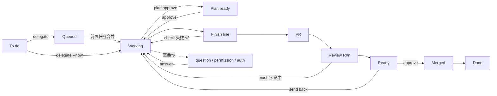
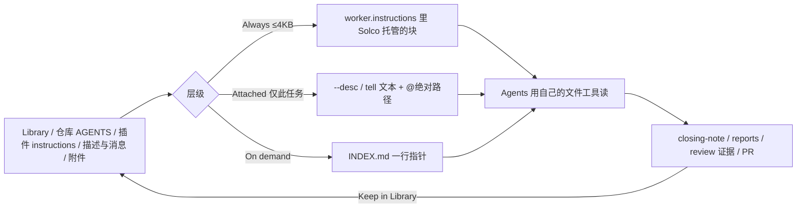

# Projects 运行界面(协调者 · 任务 · 上下文)

> 状态:**已选型(2026-10-31),P1 实施中。**
> 打开 `exploration.html`(`file://`,无依赖)。右栏 Variants 切方案,Scenes 切状态,Controls 切主题/宽度。
> 冒烟脚本:`agent-browser open file://$PWD/exploration.html && agent-browser eval "$(cat smoke.js)"`,期望 `PASS 63 checks`。

## Decision (2026-10-31)

**Chosen:** A(Coordinator-first)为底 + C 的 Run strip;Library 批准为 Solco 自有存储(仅输入、路径传递、不碰 `~/.herdr-projects`);Reports 独立只读页签;**授权进入 P1(任务运行视图,复用 Chat View)**。
**P1 状态(2026-10-31):** 已做运行条(`internal/workboard/strip.go`)、`/task` 的 Run | Review | Report 页签、输入框上方 dock(Approve… / Approve Plan… + Send Plan Back… / Pick…)与 Open Chat 跳转。Context / Changes / Settings 页签等各自数据源(Library、worktree Git 读、任务级 settings 读)到位后再加;**Chat 内嵌 /task 推迟到 chat 重构落地后单独一期**(Chat WebView 与 bridge 是 Shell 单例)。已实机安装,尚未目视验收。
**P2–P5 状态(2026-10-31):** 已做——Project 页 Tasks | Library | Reports | Auto 视图与 Coordinator Chat 按钮;Library(`internal/projectlibrary`,Always/Reference/Task 三档,托管块经后台同步写入 worker/reviewer/coordinator 三处 instructions);New Task 的 Context 勾选/Add Files…与 “What the agent will get” 预览(附件以 `Context files:` @path 行进描述);Reports 视图(含已完成任务的懒读 details、Keep in Library);Edit Description(`describe` + 可选 tell);Stop All Tasks…(逐个 stop 的宏,非原子,确认框写明);/task 的 Context / Changes / Settings 页签。仍推迟:Chat 内嵌 /task。
三个方案共用:任务运行视图(Run strip + Inspector 五页签)、Library、新建任务 Sheet。P2 起各期开工前仍按分期表验证。

## 设计问题(一句话)

`herdr-projects` 的 TUI 同时承担了「看板、协调者对话、任务运行、需要你」四件事,Solco 现在只做了看板与列表页;
任务**怎么启动、怎么看它在跑、上下文(文本/图片)怎么放、怎么停、怎么改**没有一条闭环的原生路径。目标:原生界面能替换 TUI,并复用 Chat View 的基础设施。

## Phase 0 取证

### 依赖更正

| | shepherdr `main`(2.1) | Solco 所门控的插件 |
|---|---|---|
| 是什么 | 独立 Web 应用,跑在 `herdr-core`(`hc`)上,**不是** Herdr 插件 | `eliasstravik/herdr-projects` v1.2.26,Rust 插件,来自 shepherdr 的 2.0 线 |
| 与 Solco 的关系 | 概念/路线参考(coordinators、artifacts、私有指令、autopilot、任务侧栏 Terminal/Files/Diff/PR) | `internal/workboard.Detect`,版本窗口 `1.2.x`,只经它自己的 CLI |

所以本设计的**权威是插件 CLI(`list/details --json`、`tell`、`approve`…)**,不是 shepherdr 2.1 的 API。

### 插件生命周期(见 `exploration.html` → Maps → Lifecycle)

To do → Queued(`--after`)→ Plan ready(`--plan.approve you`)→ Working(worktree,`work/<n>-slug`)→ Finish line(commit、同步 main、repo `check`,3 次)→ push + 草稿 PR → Review R#n(第二个 agent、独立 tab;`review.mustFix` 默认 major,`review.rounds` 3)→ Ready(你点头)→ squash merge → Done → 清理。

回环:check 失败、review 失败、与 main 冲突、GitHub checks 失败、你打回。旁路:chat-only、research-only、`finish`、archive、clear。限额/断供:provider cutoff 重试 1/2/4/8 分钟,`limit.time/tokens`,fallback agent 一次。

### 上下文现实(关键缺口)

- 插件**没有**项目知识库/附件库。任务上下文 = 标题 + `--desc`(`describe` 整体替换)+ `tell` + 生成的 settings 块/`rules.md` + 仓库自己的 `AGENTS.md`/`CLAUDE.md`。
- 插件设置 `worker.instructions` / `reviewer.instructions`(task/repo/you 三级,由宽到窄叠加)、`coordinator.instructions`;改动到下一条协调者消息、下一次任务启动才生效。
- 文件携带(`@path`、`[Image n]`、8 MB、30 天、落到 `<worktree>/.herdr-projects/files/`)只存在于插件自带的 board/web/remote 路径,**CLI `tell` / `add --desc` 不带文件**。
- 产物:`closing-note.md`、`reports/<repo>/<n>/`(经 `details` 链接)、review 证据。
- 协调者与任务 agent 都是普通 Herdr agent(协调者在 `Coordinator` tab,规则在其数据目录 `AGENTS.md`),keeper 进程在看板关闭时仍运行;默认权限为完全访问。

### 同类产品怎么做 Project

| 产品 | 取其所长 |
|---|---|
| Cursor Projects | 协调者不写代码;共享上下文文件同步;订阅 "Listening" 胶囊;文件 @ 只指路不内联 |
| Claude Code Projects | 指令 ≤16k 字符;项目记忆 `MEMORY.md`;Library 页签(上传是副本);Overview 按 Ready for review / Waiting on you / Working / Landing / Idle / Resolved 分组;Stop/Esc;Pause/Archive/Delete |
| Codex app | project → thread、worktree、AGENTS.md 分层、自动化 review 队列 |
| Kiro | steering 三种纳入方式 always / fileMatch / manual;specs;知识库 |

## 约束清单

- **必须保留**:插件是任务权威,Herdr 是运行时权威;只经插件 CLI 与 Herdr 插件命令;不读写 `~/.herdr-projects`;无第二套任务/Workspace 注册表;Native | Board 开关与 `herdr-projects` 门控不变。
- **必须对齐**:Chat View WebView 与其 dock 栈(Tasks / Question / Blocked / Working)、`chatsession`、`hookIdentities`、子代理抽屉、`ChatAttachments`、状态指示槽(`status_indicator.go`)、`tipped`、`controls.go`。
- **明确非目标**:不做云账号/遥测;不 inline 文件内容;不重写插件的校验与拒绝语义;不做插件市场。
- **实现落点(定稿后)**:`internal/workboard`(只读映射 + 动作薄封装)、`internal/nativeui/workboard_*.go`、Chat 桥(任务 run 视图复用)、新 `internal/projectlibrary`(仅当 Library 获批)。

## 方案

三个**结构**不同的 Project 首页;任务运行视图与 Library 共享。

| | A Coordinator-first | B Board-first | C Inbox + run |
|---|---|---|---|
| 首页 | 双栏:左协调者 Chat View,右 Overview(Tasks · Library · Reports · Auto) | 状态列看板;协调者收进底部 tray | 无首页:左注意力队列,右选中任务的 run |
| 赌注 | 你主要「说」,看板是旁证 | 你主要「扫」 | 你按需求队列逐个处理 |
| 最像 | Cursor Projects | 现有 TUI 看板 | Claude Code Projects Overview |
| 代价 | 右栏窄,30+ 任务难扫 | 协调者存在感弱 | 「项目即容器」感弱,Library 只有底部入口 |

共享部分:

- **Run strip**:Work / Check / PR / Review / Approve / Merge 六段,当前段高亮;数据只来自 `list/details` 的 `stage/state/kind/msg`。
- **Inspector 五页签**:Run(状态 + 板上发生了什么)/ Context(已给的与可读的)/ Changes(git workbench 的 +/-,`ReviewChanges` 进 Diff Review)/ Review(轮次、findings、must-fix)/ Settings(本任务的 agent/model/review/merge)。
- **dock 栈**:`ask` 用 Question dock,`plan` 用 Plan dock(Approve / Edit / Send back),`ready` 用 Ready dock(Approve & merge / Send back,`approve` 重新读状态,绝不 `--anyway`)。

## 上下文模型(Library)

- **存放**:`<userDataDir>/ProjectLibrary/<repoKey>/` + manifest + 生成的 `INDEX.md`;**只放输入**,持久;单文件 ≤32 MB;疑似凭证的文件拒收。
- **三层**:Always(≤4 KB 预算,每轮都发)/ Attached(只给某任务,经 `--desc`/`tell` 的 `@绝对路径`)/ On demand(只进 INDEX,agent 需要时自己打开)。
- **传递只走插件自己的通道**:`*.instructions` 里一个 Solco 托管块指向 INDEX.md,加上消息文本里的 `@abs/path`。永不 inline 内容。
- **新鲜度**:任务启动时冻结;运行中任务要更新就 `Tell`。
- **可见性**:新建任务 Sheet 右侧 "What the agent will get" 预览(含完全访问警告);Chat 里的文件 chip 带 "opened N×",仅由 transcript 的 read 工具行推导,看不到就不写。
- **产物**:独立只读 Reports 页签,经 `details` 链接;"Keep in Library" 把一份报告转成下一个任务的参考,闭环。

## 控制矩阵(每个 UI 动作只对应一个插件动词)

完整表见 `exploration.html` → Maps → Controls matrix;TUI 对照见 TUI parity。要点:

- Stop 任务 = 插件的 stop(工作保留,回复即恢复);"Stop everything" 是**组合宏,非原子**,UI 要写明。
- Edit task = `describe`(整体替换)+ `tell`(增量);Settings 页签 = 插件 `set/unset` 的任务级项。
- 协调者输入框:pane 活着就直发 prompt,否则回落 `coordinator tell`。
- 破坏性动作(clear、archive 带未合并改动)走既有确认路径。

## 协议缺口与风险

| # | 缺口 | 处理 |
|---|---|---|
| G1 | 没有项目附件库,CLI 不带文件 | Solco 自有 Library + 路径指针(**需明确决策**) |
| G2 | 评审者/协调者会话身份有歧义(同一 cwd) | 沿用 `hookIdentities` 按 pane 记;不确定时只读展示,不绑定 Chat |
| G3 | 没有逐事件时间线 | Run 页签只显示 `details` 能给的;不伪造 |
| G4 | 跨机器无文件携带 | 远端实例整个 workboard 本就隐藏;Library 不尝试跨机 |
| G5 | 默认权限是完全访问 | Brief 预览固定显示警告;`worker.access` 只作展示/跳转设置 |

## 分期(定稿后)

| 期 | 内容 | 验证 |
|---|---|---|
| P1 | 任务 run 视图(Run strip + Inspector + dock),复用 Chat View | `GOTOOLCHAIN=auto go test ./internal/workboard/... ./internal/nativeui/...`;真机对一个运行中任务逐页签对照 TUI |
| P2 | 协调者 Chat + Project 首页 A | 真机:协调者发一句话,任务出现在 Needs you / Working 分组 |
| P3 | 新建任务 Sheet + Brief 预览 | 预览内容与实际发出的 `add` 参数一致(单测断言) |
| P4 | Library + Reports(若获批) | 路径指针单测;拒收凭证文件;INDEX.md 重生成 |
| P5 | Stop/Edit/Auto 管理面与 TUI 对等清单收尾 | TUI parity 表逐行勾选 |

通用:`git diff --check`;`GOTOOLCHAIN=auto go tool mygo vet .`;`GOTOOLCHAIN=auto go tool mygo build`;日志不含 prompt/对话正文。

## 已知局限(探索稿本身)

- 数据是示例(7 个任务、5 个 Library 项),不连插件。
- Maps 里虚线(如 Keep in Library)会穿过部分方块,仅为示意。
- 只在 Chromium(agent-browser)`file://` 下验证;未做 375px 手机宽度(这是桌面 App)。

## 待确认

1. 首页选 A、B、C,还是 A + C 的 Run strip(推荐)?
2. Library 是否批准为 Solco 自有存储(推荐批准,仅输入、路径传递、不碰 `~/.herdr-projects`)?
3. Reports 是否独立页签(推荐)?
4. 是否授权进入 P1?

## 决策记录:Projects 改为 WebView(2026-10-31,用户批准)

- 原生 P2–P5 实现与设计稿差距大,**整套 Projects(首页、任务页 Run strip/Inspector/dock、New Task 面板、Library/Reports)改为 WebView 页**,**直接替换原生页**,不保留原生回退。
- 页面中栏内嵌既有 Chat `<App/>`(协调者或任务 Agent),右栏为 Tasks/Library/Reports/Auto 与 Run/Context/Changes/Review/Settings 页签;基线仍是 `exploration.html` 的 A + C Run strip。
- 数据只经 `projects` 桥(Snapshot + 事件),写操作只走既有 Shell 函数;插件仍是任务权威,Library 仍是 Solco 自有存储。
