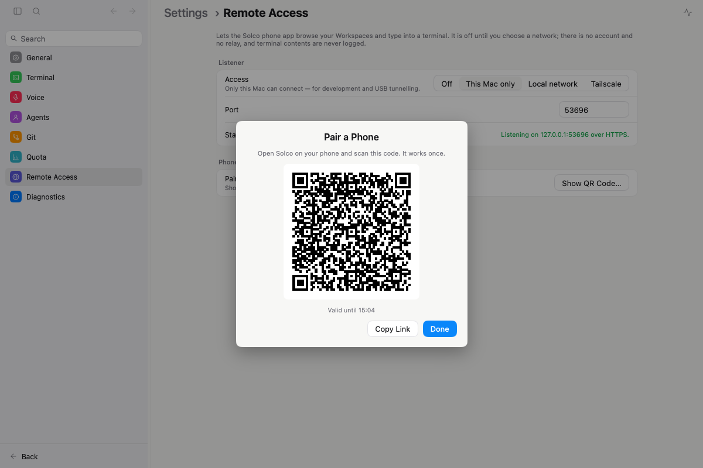

# Remote Host (Go) — 手机客户端的服务端

> 本目录是 **Decision + 协议草案 + P1 任务清单**,不含探索 HTML(没有视觉分歧可选;视觉在 `designs/mobile-shell/`)。
> 上游:`designs/mobile-shell/README.md`(手机壳 Decision = C 窥视条 + 终端层)。

## Decision (2026-10-31)

| 项 | 结论 |
| --- | --- |
| **Status** | `Approved`(设计);**产品代码尚未开工**,下一句「开始 P1」才进入实现 |
| **形态** | App 进程内挂载的 `internal/remotehost`;**包本身不 import MyGo**(日后可原样搬进无头二进制) |
| **分期** | P1 列表 + 终端 + 窥视行 → P2 Chat 只读 → P3 Chat 发送与交互 → P4 余下(`/` `$` 目录、附件、语音、通知另议);**每期独立可合并** |
| **传输(首期交付)** | loopback → LAN HTTPS/WSS + QR 配对 → **Tailscale 同期交付**(沿用旧 `remote-client-architecture.md` §10 的顺序;Relay / WebRTC / QUIC 不做) |
| **终端模型(2026-10-31 探针后修订)** | **observe + API 输入,不 attach**:输出走 `herdr terminal session observe <terminal_id> --cols N --rows M`(Herdr 以手机自己的栅格渲染 VT 帧,可与桌面的 controller 并存,**不 resize、不重排 Mac 上的窗格、不需要 `--takeover`**);输入走 Herdr 既有的 `pane.send_input` / `pane.send_keys`(同桌面 `launch_transport.go` 的路径)。用户原先选的「接受 Mac 端重排」因此**不再需要**(探针证明 attach 路线根本不可行,见「实测」) |
| **授权** | `AGENTS.md` 已追加 Product decision(默认 off、配对、可撤销、无云账号、无遥测);`remote-client-architecture.md` §7 已改写为 observe + API 输入 |
| **拒绝的备选** | ① 手机直接驱动桌面 Shell 的选中状态(= 遥控 GUI,违背「导航客户端本地」);② 整机一个共享 TUI session(旧 §7);③ 手机 `terminal attach`(**探针实锤不可行**:一个终端同一时刻只允许一个 attached client,桌面可见窗格已占用,第二个会被拒并要求 `--takeover`,而自动 attach 永不 takeover);④ 手机 `--takeover`(会把桌面挤下线,桌面的 MyGo 终端对被挤的反应未验证,且违反既有规则);⑤ 只放进 `nativeui`(Chat 无法脱离 Shell 复用与测试) |

## 事实依据(调研,可复核)

| 事实 | 出处 |
| --- | --- |
| Go 版无任何监听服务;`solco-mobile` 的 `/api/v2` 与 golden fixtures 对着已退役的 Rust Host | `rg "net.Listen\|http.Server" internal` 仅 services/preview/apphook(均非 Host) |
| 桌面终端 = 每 pane 一个 `herdr terminal attach <terminal_id>`,**永不 `--takeover`**;同一终端只允许 1 个 attached client | `internal/herdr/herdr.go` `TerminalAttachCommand`;探针(下) |
| `herdr terminal session observe <id> --cols --rows`:多观察者、自带栅格、输出 JSON 行 `terminal.frame`(base64 ANSI,首帧 `full:true`,之后增量) | 探针(下),herdr 0.9.5 |
| 窥视行所需的「最后一行」= `Manager.ReadPane(visible)`,不解析 ANSI,不新增 Herdr 方法 | `internal/herdr/launch_transport.go:351` |
| Chat 投影 `ChatBridgeState` 是 `*Shell` 方法,绑定窗口当前选中的那一个 pane,且须上 UI lane(`callOnWindow`) | `internal/nativeui/chat_bridge.go`、`shell.go`(`chatTurns/chatPaneID`) |
| 可脱离 Shell 复用的底座:`history/live.go` tail + `conversation.DeriveTimeline` + 投影 JSON 形状 | `internal/history`、`internal/conversation` |
| go.mod 目前无 PTY 与 WebSocket 库 | `rg "pty\|websocket" go.mod` 无命中 |

## 约束

- Herdr 仍是唯一运行时:Host **只经 Herdr API/CLI 与既有域包取数**,不建第二套 workspace/pane/终端/进程生命周期。
- 手机的 Workspace/Tab/Pane/Agent 选择**完全客户端本地**,Host 绝不移动 Mac 用户的导航。
- Host 从不 attach、从不 `--takeover`:每个终端 WS 起一个 `terminal session observe` 子进程(只读),连接关闭即回收;不为未打开的终端保留 observe。输入只走 Herdr API。
- 日志只记操作名、稳定 ID、错误、计数、耗时;**不记终端字节、prompt/会话正文、令牌、配对码**。
- 无云账号、无遥测、无 Solco 自营 Relay。
- 默认 `off`;监听模式只在用户于 Settings 显式选择后生效,网卡变化不静默放宽暴露面。

## 监听与信任

```text
Settings → Remote Access
  Mode: Off | Loopback | Local network | Tailscale
  Devices: name · paired · last seen · [Revoke]
  [Pair a phone…]  → 弹出 QR(6 分钟、单次有效)
```

- **证书**:首次开启时生成自签 ECDSA 证书,存 `<userDataDir>/RemoteHost/`;私钥权限 0600。手机端**按指纹固定**(pin),不依赖 CA。
- **QR 负载**(只含引导元数据,不含可复用持久凭据):
  `solco://pair?h=<host>&p=<port>&fp=<sha256 指纹>&c=<一次性配对码>&n=<Mac 名>`
- **配对**:`POST /api/v3/pair {code, deviceName}` → 校验指纹已在 TLS 层被手机固定 + 配对码未过期未使用 → 返回 `{deviceId, token}`(256 位随机)。Host **只存 `sha256(token)`**、名称、创建/最后见时间(`<userDataDir>/RemoteHost/devices.json`);手机存 SecureStore / Keystore。
- **鉴权**:HTTP `Authorization: Bearer <token>`;WebSocket 用子协议对 `['solco.bearer', token]`(浏览器不能设头;沿用手机端既有规则,前缀为 `solco.bearer`)。
- **授权域**:V1 单一「owner」权限,但所有端点过同一个 `authorize(scope)` 入口,保留日后拆 `view / prompt / terminal-input / manage` 的缝(终端输入比 prompt 权力更大,单独成 scope)。
- **撤销**:Settings 的 Revoke 删除记录并**立刻**关闭该设备的所有 WS。

## 协议草案(P1,`/api/v3`;v2 随 Rust Host 退役)

| 端点 | 作用 |
| --- | --- |
| `POST /api/v3/pair` | 见上,无需 Bearer |
| `GET /api/v3/bootstrap` | `{hostId, hostName, version, capabilities:{terminal:true, chat:true}, instances:[…]}` |
| `GET /api/v3/tree?instance=` | Herdr 投影的只读形:`workspaces[] → tabs[] → panes[]`,每 pane 带 `paneId`、`terminalId`、`label`、`agent?{provider,status}`、`cwd`;全是不透明 ID,**不含任何「聚焦」字段**。带 `revision`(仅内容变化才递增;分支名 Herdr 投影里没有,P1 不给) |
| `WS /api/v3/events` | 首帧 `hello{revision}`;之后只推 `tree.changed{revision}`(不做 diff,客户端重取 `/tree`,用 `If-None-Match` 省流量;树内容没变(如 Mac 上换了聚焦)就不推)。状态槽的变化已在树里(`agent.status`/`blocked` 等),不另设事件 |
| `WS /api/v3/terminals/{terminalId}/stream?cols=&rows=` | **下行**:二进制帧 = observe 的 `terminal.frame.bytes` 解 base64 后的 ANSI(`full` 帧与增量帧原样转发,另有一条 JSON 文本帧 `{"t":"frame","seq":n,"full":bool,"w":51,"h":19}` 先于其字节,供手机核对栅格);**上行**文本帧 JSON:`{"t":"input","text":"ls","keys":["enter"]}`(先字面文本、后具名键,一次 `pane.send_input {pane_id,text,keys}`;文本 ≤ 64 KiB、键 ≤ 32 个且只许 `[A-Za-z0-9+_-]{1,32}`;被拒回 `{"t":"input.error","code":"bad_input|refused|forbidden"}`,`refused` 带 Herdr 原话)、`{"t":"resize","cols":60,"rows":22}`(合法范围 10–400 × 3–200,爆发式只算最后一次,去抖 100 ms)、`{"t":"ping"}`(回 `{"t":"pong"}`)。**resize = 用新栅格重启 observe**(observe 的 stdin 不接受 resize 消息,探针已验证),新子进程首帧是整屏 `full:true`,所以软键盘弹起/收起代价只是 ~1 KB |
| `GET /api/v3/panes/{paneId}/chat` | **P2 只读 Chat**:窗格 → Herdr `agent_session` 身份 → Provider 自己的转录 → `chatsession.State`(`provider/model/contextTokens/hasOlder/working/plan/subagents/turns`,回合形状与桌面页完全相同);无 agent_session 或文件未写出 = `409 no_conversation`(手机退回 Terminal),未知 pane `404`。改动卡只有文件名(无 `+/−`:那来自 Mac 的工作树快照) |
| `WS /api/v3/panes/{paneId}/chat/stream` | 首帧即 `{"t":"chat","paneId","state"}`,之后文件有增量(1 s 轮询,stat 级)或子代理目录变化(每 4 s)且序列化结果不同才再推;会话换了(新 session 文件)自动重绑,pane 没了 `4404`、会话没了 `4409`;每设备 ≤4 路 |
| `POST /api/v3/panes/{paneId}/chat/send` | **P3 发送**:`{text, interrupt?}`(text ≤ 64 KiB)。与桌面同一门禁:Herdr 状态 idle/done 才发;working 回 `409 busy`,带 `interrupt:true` 才先 Esc → 600 ms → Ctrl-C → 200 ms → 再发;blocked/failed 回 `409 needs_terminal`(手机引导去 Terminal);unknown `409 not_ready`;shell 窗格 `409 no_agent`。投递 = Herdr `agent.prompt`(含它自带的两类身份拒绝回退),Herdr 的拒绝原样 `409 refused{message}`,`DeliveryUncertain` 回 `504 delivery_uncertain` 且 Host 永不重发。需要 `ScopeTerminalInput`;提示正文不进日志 |
| `POST /api/v3/panes/{paneId}/chat/answer` | **P3 Question 卡作答**:blocked 的 agent 会在聊天读取/流帧里带 `interaction{id,kind,header?,prompt,options,descriptions?,multi?,textOptions?,step?,steps?}`(omp/pi 的 `ask` 来自转录;Claude 的 AskUserQuestion/权限页来自 `pane.read` 刮屏,≥1.2 s 节流)。请求 `{interactionId, option?, options?, text?}`:单选发 `option`,多选发 `options`(可空),文本行(`textOptions`)须带 `text`。`id` = pane+来源+步数+问题+选项的哈希,答题时 Host 重新派生并比对,过期/已答 `409 interaction_gone`;未知选项 `400 unknown_option`;非 blocked 同样 `interaction_gone`。按键与桌面共用 `conversation.AnswerKeys/MultiSelectKeys`(方向键+确认键,绝不发数字);投递 = Herdr `agent.send_keys`,文本答案 = 选中该行后 `agent.prompt`(被阻塞的输入框回退 `pane.send_input`),Herdr 拒绝原样 `409 refused`;刚答过的卡 2.5 s 内隐藏;答案正文不进日志 |
| `POST /api/v3/panes/{paneId}/chat/stop` | 一次 Esc(`agent.send_keys`,与桌面 Stop 相同),回 `{ok:true}` |
| `GET /api/v3/panes/{paneId}/peek` | 窥视行:`ReadPane(visible)` 的最后一条非空行,≤ 200 字节,纯文本;Host 侧每 pane 节流 1 s |

要点:
- **键行/修饰键**不在 Host 编码:手机端(沿用 `tui-virtual-keyboard-design.md`)直接上行字节,Host 不做 `tui_input` 语义翻译。
- 每设备最多 2 个并发终端流(超出返回 `429`);observe 起不来(终端已不存在、Herdr 拒绝)以 WS 关闭码 + 机读 `reason` 返回,手机显示 Blocked/Offline。
- 重连 = 新 observe,首帧即整屏;Host 不缓存终端内容。
- 手机端渲染器必须吃 Herdr 的 ANSI 帧(含 `?2026` 同步输出、OSC 8 序列):沿用 `tui-virtual-keyboard-design.md` 的键行,输出端用真 VT 渲染器(不再需要手机自己解码 PTY 字节语义)。
- 输入受 Herdr 对 `send_input`/`send_keys` 的身份与就绪门约束:拒绝原样回传给手机(不绕过);窗格里**不是 Agent** 也能收键(`pane.*` 路径,不是 `agent.*`)。
- `capabilities.chat`:P2 起为 `true`;单个窗格没有可读会话时回 `409 no_conversation`,手机对该窗格隐藏 Chat(退化成 Terminal)。路径用 `panes/{paneId}` 而非规划时的 `agents/{ref}`:树里的不透明 ID 就是 paneId,Agent 没有独立 ref。

## 包布局(P1;已落地部分见 `internal/remotehost/CLAUDE.md`)

```text
internal/remotehost/
  CLAUDE.md            L2 头(成员清单 + [PROTOCOL])
  config.go            Mode / 端口 / 允许网卡 的纯数据与校验
  tls.go               自签证书的生成、加载、指纹
  pairing.go           一次性配对码(6 分钟、单次、常量时间比较)
  devices.go           设备库(token 哈希、撤销、last seen),原子写盘
  server.go            监听器生命周期、路由、authorize(scope)+guard、pair/bootstrap/tree、撤销→关 WS
  tree.go              herdr 投影 → /tree 形状(纯函数)
  events.go            herdr 事件 → /events 帧
  backend.go           Backend 接口(Instances/Projection/Subscribe/SendPaneInput/ObserveCommand)+ Manager 适配
  terminal.go          observe 子进程(stdout JSON 行)↔ WS 桥 + 输入经 Herdr API(无 PTY)
  peek.go              ReadPane → 最后非空行(纯函数 + 节流)
  *_test.go
internal/nativeui/
  page_settings_remote.go   Settings → Remote Access(开关、Mode、配对 QR、设备与 Revoke)
  settings_search.go        追加索引(TestSettingsIndexCoversEveryRow 守卫)
```

接口缝:`remotehost` 只依赖一个小接口(`Tree(ctx) / Events() / AttachCommand(session, terminalID) / ReadPane(…)`),由 `internal/herdr.Manager` 的薄适配实现;**不 import `nativeui`、不 import MyGo**。

### 新依赖(待实现时确认版本;当前 go.mod 均没有)

| 依赖 | 用途 | 为什么不用更省的 |
| --- | --- | --- |
| `github.com/coder/websocket` | WS 服务端(二进制帧、子协议、关闭码) | 标准库无 WS;`x/net/websocket` 已被官方标为不推荐 |
| 二维码生成(一个小库,如 `github.com/skip2/go-qrcode`) | 配对 QR | 仅在设置页绘制;MyGo 若已有 QR 能力则优先用它(实现前先查) |

## P1 任务清单(`[步骤] → [验证点]`)

1. **探针 ✅ 已完成**(2026-10-31,隔离 session `probe-p1`,用后已删除,默认 session 未动):见「实测」。结论使终端模型由 attach 改为 observe + API 输入。
2. ✅ **`config` + `tls` + `devices` + `pairing`**(2026-10-31 已实现)→ `go test ./internal/remotehost/...`:配对码过期/重复使用被拒、token 只存哈希、指纹稳定、设备库原子写与撤销。
3. ✅ **`auth` + `server`(loopback)**(已实现:`server.go` 含 pair/bootstrap/tree/授权/撤销)→ 无 token 401;错误子协议被拒;撤销后既有 WS 被关;`off` 模式不监听端口。
4. ✅ **`tree` + `events`**(已实现)→ 用 `internal/herdr` 现成夹具驱动:ID 全不透明、`revision` 递增、`If-None-Match` 304、事件触发 `tree.changed`。
5. ✅ **`terminal`**(已实现,另有真 herdr 的可选契约测试)→ 假 observe 子进程(打印 `terminal.frame` JSON 行的脚本)驱动:帧有序转发、`resize` = 重启并换栅格、关闭回收子进程、每设备并发上限、argv 恒为 `terminal session observe <id> --cols --rows`(断言无 `attach`/`--takeover`/`control`)、输入只调 Herdr API(假 Manager 断言)。
6. ✅ **`peek`**(已实现)→ ReadPane 夹具:空屏/ANSI 残留/超长行的截断与节流。
7. ✅ **LAN / Tailscale 绑定**(已实现:`Candidates` + `Server.Reconfigure`)→ 只绑所选网卡地址;Mode 变更时重绑;`0.0.0.0` 永不默认(单测断言)。
8. ✅ **Settings → Remote Access 页** + 搜索索引 → `TestSettingsIndexCoversEveryRow` 绿;默认关;配对 QR 6 分钟后失效。
9. ✅ **文档同步**:`internal/remotehost/CLAUDE.md`、`internal/CLAUDE.md`/根 `CLAUDE.md` 的目录清单。
10. **总验**:`GOTOOLCHAIN=auto go test ./...` · `GOTOOLCHAIN=auto go tool mygo vet .` · `GOTOOLCHAIN=auto go tool mygo build` · `git diff --check`;真机:手机配对 → 列表 → 点开终端 → 输入 → 回显 → Revoke 后断开。

## P2–P4 轮廓(不在本期)

- **P2 Chat 只读(✅ Host 侧已实现 2026-10-31;手机 UI 另做)**:从 `nativeui` 抽出与 Shell 无关的 `internal/chatsession`(一个 Agent 的 tail + `DeriveTimeline` + plan + working + changes 的投影构造),**桌面 `ChatBridge` 与 Host 共用同一投影函数**;抽取过程以桌面测试(`chat_*_test.go`)零改动通过为护栏。`capabilities.chat=true`,新增 `GET /api/v3/agents/{ref}/chat` + 事件流。
- **P3 发送与交互(✅ Send/Stop/interrupt 与 Question 卡作答已实现 2026-10-31(真 omp 回归:转录派生出卡 → 手机答 blue → omp 继续并回 `picked blue`;纯函数 `TranscriptQuestion`/`DetectScreenPrompt`/`AnswerKeys` 已抽到 chatsession/conversation,桌面改调同一份,桌面测试全绿);❌ 未做:Queue 跟进账本、picker(/model 等)——它们仍绑在 nativeui 的 broker/watcher 上)**:`Send/Stop/Queue`、Question/Blocked 卡、picker;逻辑沿用 `chat_hooks/ask/picker` 抽出的纯逻辑;投递仍是 Herdr `agent.prompt/send_keys`(含既有两类身份拒绝回退),不新增 Herdr 方法。
- **P4**:composer 目录与附件、语音、通知(另议)。

## 风险与最脆弱假设

- **本方案假设**:`terminal session observe` 在 Herdr 0.9.x 之后的版本里保持「可并存、自带栅格、不影响 controller」的语义,且其 JSON 行格式不变。它是 Herdr 的 CLI 子命令而非文档化的稳定 API——若将来改动 → 降级为 `ReadPane` 轮询渲染的只读终端层;Host 把 observe 隔在 `terminal.go` 一处,并在 P1 加一条针对真实 herdr 的**可选契约测试**(有 `herdr` 就跑,没有则跳过)。
- 自签证书 + 指纹固定的 UX:iOS/Android 对自签 WSS 的支持需在手机端用原生 pin 而非系统信任库(RN 端要走 `fetch` 之外的实现);**这是手机端的工作量,不是 Host 的**,但会拖 P1 的端到端验收。若代价过高 → loopback + SSH 转发作为开发期路径,先不阻塞 Host。
- Tailscale 路径下机器名/地址由用户选择;Host 只绑所选地址,不探测、不记录 tailnet 信息。
- 抽 `chatsession` 是本计划里最大的重构(P2);P1 完全不依赖它,所以不会被它拖住。

## 实测(2026-10-31,herdr 0.9.5,隔离 session `probe-p1`)

脚本 `/tmp/probe_attach.py` 等(一次性,未入库);默认 session 全程未动,探针 session 已 `server stop` + `session delete`。

| # | 操作 | 结果 |
| --- | --- | --- |
| 1 | 控制端 A `terminal attach` 140×42 → 窗格里 `stty size` | `42 140`:窗格 PTY 跟随 **attach 客户端**的栅格 |
| 2 | 第二个 `terminal attach`(51×19,无 `--takeover`) | **被拒**:`terminal … already has an attached client; retry with --takeover`,进程退出码 1。**一个终端同时只允许 1 个 attached client** |
| 3 | `terminal session control` 无 takeover,A 仍在 | 同样被拒(`terminal.closed` + 同一原因) |
| 4 | `terminal session observe <id> --cols 51 --rows 19`,A 仍在 | **成功**;窗格 `stty size` 仍是 `42 140`(**不重排**);输出为 JSON 行 `{"type":"terminal.frame","encoding":"ansi","bytes":<base64>,"full":bool,"seq":n,"width":51,"height":19}` |
| 5 | 两个 observer 并存(51×19 与 40×15) | 均成功 |
| 6 | observe 期间经 `pane send-text` 输入 | 增量帧(`full:false`,约 80–120 字节,含 `?2026` 同步输出)实时到达;`pane send-text` 的字符进入窗格 |
| 7 | 向 observe 的 stdin 写 `{"type":"resize",…}` | 无效果(无新帧)→ 改栅格要重启 observe |

后果:
- 手机 attach 路线**不可行**(桌面可见窗格已占 controller 位),takeover 又违反既有规则 → 终端模型改为 observe + API 输入,上文已全部改写。
- 原本需要用户拍板的「是否接受 Mac 端重排」不再成立:observe 完全不影响桌面窗格尺寸,手机端栅格独立。
- 仍未验证(P1 任务内补):`send_keys` 的键名表(`up`/`ctrl+c`/`esc`…)与手机键行的映射全集;大量输出时的帧率与背压;窗格关闭时 observe 的收尾帧;observe 对「隐藏 Tab 的终端」(桌面没有 attach)是否同样可用。

## 进度(2026-10-31)

- ✅ 任务 1–5 已实现并通过 `GOTOOLCHAIN=auto go test -race ./internal/remotehost/`(连续三次)。
- ✅ **真 herdr 契约测试**(`SOLCO_REMOTEHOST_CONTRACT=1 go test -run RealHerdr ./internal/remotehost/`):隔离 session 里 WS 打开终端 → 首帧是 51×19 整屏 → 经 Host 输入 `echo HELLO_FROM_$((1+1))PHONE` → observe 帧里回显 `HELLO_FROM_2PHONE`;测试结束 session 已删除。
- 新增依赖:`github.com/coder/websocket v1.8.15`(用户 2026-10-31 同意);未引入 pty 库(observe 不需要 PTY)。`go mod tidy` 在本机因网络卡住,go.mod 手工置为直接依赖,联网后请补跑一次 `go mod tidy` 复核。
- ✅ 任务 6 `peek`(`GET /api/v3/panes/{paneId}/peek`,每 pane 1 s 节流)、任务 7 地址候选 + `Reconfigure`(换模式/地址/端口即重绑、作废配对码、失败保持停止)、任务 8 Settings → Remote Access(`internal/nativeui/remote_settings.go`)与 App 挂载(启动时仅在上次选了模式才监听,退出时停)。二维码依赖 `github.com/skip2/go-qrcode`(MyGo 无二维码能力,用户 2026-10-31 同意引入);界面渲染出的二维码用 macOS CIDetector 解码,内容与配对 URL 逐字一致。
- 剩余 P1:任务 9 文档收尾(L2 已同步)、任务 10 总验与真机(扫码配对 → 列表 → 终端 → 窥视行)。



## 后续候选(用户 2026-10-31 提问:手机端能否操作 Herdr TUI?)

可以,但不在 P1–P4:Herdr 的 TUI 本体(侧栏 + 多窗格界面,`herdr session attach <name>`)不是某个 `terminal_id`,`observe` 帮不上;要给手机一个「Herdr TUI」面,只能由 Host 在 PTY 里跑一个 Herdr TUI client 并转发(= 旧 Rust Host 的「共享 TUI session」模型)。代价:Herdr 的焦点/布局是全局的,手机在 TUI 里的操作会**改动 Mac 上同一 session 的焦点与 resize**,与「手机导航客户端本地」冲突,所以只能是一个明确标注「会影响 Mac」的高级入口,另起一期(P5)并重新评估(那时才需要 `creack/pty`)。日常的「看 + 打字进某个终端」已由 P1 覆盖,Agent 的结构化操作走 P2/P3 的 Chat。

## 决议补记(2026-10-31,用户确认)

- **手机的 Mac 列表**:一台 Mac = 一张卡(以证书指纹为 id),最多 8 台 × 5 个历史地址,只存 SecureStore;「地点」用连接方式标签(局域网 / Tailscale / 本机 USB,由地址段判断)+ 连接时的手机网络类型(Wi-Fi/蜂窝),不取定位;移除当前 Mac 后不静默切到别的。当前地址不通时,手机并行试该 Mac 的历史地址,最先通的成为当前地址(同证书同 token)。连接失败页按超时/拒绝/不可达/指纹不符/401 分类,显示地址、路线与手机网络。
- **标题与活动时间对齐桌面**:Host 不解析会话文件,只转发桌面已算好的标题链(会话标题 → agent name(过滤 Solco 生成的 `kind-xxxxxx`)→ provider 显示名)与最近活动时间;只覆盖桌面当前显示的 Herdr session,其它 session 退回 provider 显示名。标题单独变化没有 Herdr 事件,由快照发布方调用 `Server.Poke` 让已打开的 events 套接字立即重算(150 ms 去抖,内容真变才推 `tree.changed`)。手机 Idle 分组不轮询 peek。
- **跟进队列重试**:保留项(agent 未到 turn 边界)每 5 s 重试,最多 120 轮(≈10 min)后以可恢复失败收尾;桌面队列同样生效。
- **LAN 候选**:排除 `bridge*`/`feth*`/`vmnet*`/`utun*` 等虚拟接口,`en*` 优先;候选标签带网卡名。已保存的地址若不再在候选里(网络变了或是 VM 网桥),Settings 的 Address 行出现警示并提供「Use <推荐地址>」一键切换。起因:手机曾被配对到 `bridge100`(192.168.139.3)而超时,真正可达的是 `en0`(192.168.5.59)。

## 决议补记(2026-11-01,用户确认)

- **接入自托管 alma-relay**:用户确认接入 2026-11-01 自托管的 [yetone/alma-relay](https://github.com/yetone/alma-relay)(https://relay.7200.online,Cloudflare Workers + Durable Objects 版)。桌面 Mac Host 作为 agent 拨出注册(`GET wss://<relay>/agent?th=<sha256hex(relaySecret)>`,首帧 `register`),手机经 relay 的 `ANY /c/<token>/…` 透传访问既有 `/api/v3`——**业务 API、请求、响应与 golden fixtures 零改动**;线协议逐字遵守 relay 的 `docs/PROTOCOL.md`(两端共用)。落地:`internal/remotehost/relay.go`(RelayConfig + relay-secret)+ `relayclient.go`(隧道客户端);Settings → Remote Access 增 Relay 区(开关、Relay Address、Registration Key、Relay Status),持久化进 `settings.Remote`。
- **V1 明文中继边界(已接受的取舍)**:relay 可见请求头与正文(它本就是传输层);持有注册权者(`RELAY_REGISTRATION_KEY`/`RELAY_TOKEN_SECRET`)可重放某手机的 Bearer 而获得同一访问面。端到端加密(alma-relay 的 E2E 路线,`/__alma_e2e__` wopen-only)列为后续,另行决议。
- **QR 增 r/rt**:`solco://pair?h=&p=&fp=&c=&n=` 在 relay 开启时追加 `&r=<relay 基址>&rt=<relaySecret>`;relaySecret 是本地生成的 256-bit 随机值、URL 安全字母表([A-Za-z0-9_-],43 字符),存 `<userDataDir>/RemoteHost/relay-secret`(0600,原子写),缺失/损坏即重建(与证书同语义),只意味着手机要重新配对;relay 侧只存 `sha256hex(relaySecret)`。
- **WS query token**:经 relay 的 WS 没有头也没有子协议(alma-relay 的 `wopen` 只带 path+query),所以 `bearerToken` 增加第三通道 `?token=`(与 `/chat/files` 的搜索词同名——带头时头优先,无头时搜索词只会 401,不冲突);LAN 直连 WS 仍用 `['solco.bearer', token]` 子协议不变。日志绝不记 query。
- **回环桥设计**:relayclient 启动一个仅绑 `127.0.0.1` 随机端口的内部 `http.Server`,`handler` 就是既有的 `Server.Handler()`(mux/guard/WS 全复用);`hreq` 剥 `/c/<secret>` 前缀打回环(响应头立即 `hres`、body 流式 `hchunk`)、`wopen` 对回环拨 ws 客户端到同路径(query 原样)。回环 listener 是实现细节,不进用户配置,**绝不产生非回环监听**;agent 套接字断开即取消全部在途请求与桥接。重连指数退避 1s→30s 带抖动、成功归零,close 4000(哈希被占)终态停止重拨。
- **对外拨出的 TLS 群组(2026-11 网络实测,中国网络)**:GFW 会静默丢弃以 `X25519MLKEM768`(后量子)为首选 key share 的握手,Go 1.24+ 默认把它排在首位,直连 Cloudflare 边缘会超时;relayclient 的拨出 `*tls.Config` 固定 `CurvePreferences = [X25519, P-256]`(排除 ML-KEM),重连全程生效,并有单测钉住;回环桥不受影响。
   - **router 24 MB body 上限已知**:Cloudflare 版 relay 对请求体限 24 MB(Durable Object WebSocket 消息 32 MiB 帽内),等待响应头 120 s;手机经 relay 上传大附件(单文件上限 32 MB)在 V1 会被 413 拒——直连 LAN/Tailscale 不受限。
   - **agent 流寿命与自愈(2026-11 实测,本机经 TUN 代理)**:即便有 20s keepalive,agent WSS 约 4 分钟被中间层静默清除一次(与活动无关);keepalive 把死窗压到 ≤30s(Pong 超时→秒级重拨),死窗内手机的 hreq/WS 会被 relay 以 502/1012 `Desktop disconnected` 立即回绝,客户端重试即可。生产契约测试连续通过即含此重拨路径。
- **生产验证与线径事实(2026-11-01 契约测试)**:新增可选真生产契约 `prodrelay_contract_test.go`(`SOLCO_RELAY_PROD_CONTRACT=1 RELAY_KEY=<注册钥匙> go test -run TestProdRelayContract ./internal/remotehost/`,不进 CI)——真拨出 → 经 relay 真配对(一次性码)→ bootstrap/tree 透传 → 坏 token 401 → Revoke 后 401,连续通过。两个硬事实:① **两版 relay 实现(index.mjs/worker.mjs)转发的 hreq/wopen path 都是剥掉 `/c/<code>` 的裸路径**(PROTOCOL.md 口径含糊),`loopbackURL` 同时接受裸路径与 `/c/<own-secret>/` 全前缀、拒绝异己前缀,假 relay 夹具已改为贴真实 wire;② **agent WSS 需要 keepalive**(20s Ping/10s Pong 超时,CF hibernation 协议层自动应答不唤醒 DO)——本机实测经代理/中间层时注册后数秒即被静默清流,hreq 投进半开套接字,keepalive 把静默死链变成秒级重拨。部署侧:Worker `alma-relay` 已设 `RELAY_REGISTRATION_KEY`,自定义域 `relay.7200.online`(CF 自动建 DNS),`/healthz`、官方 e2e(HTTP/SSE/WS 透传)、注册门禁(无钥匙 4003)均实测通过。注意 `newRelayHarness` 无条件把 `relayHooks.dial` 指到进程内假 relay,任何真生产拨号测试必须自行组装 Server。
