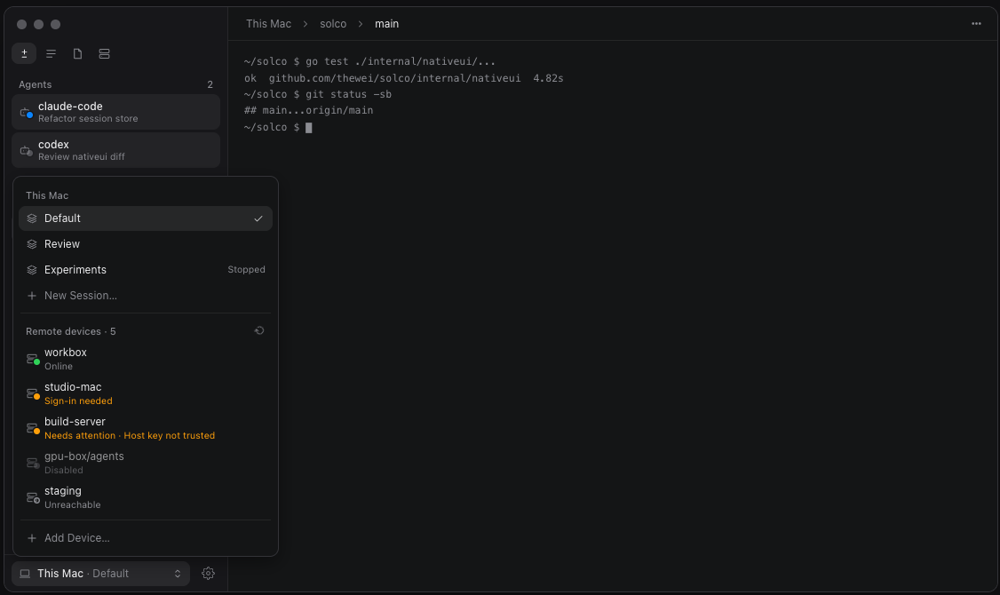
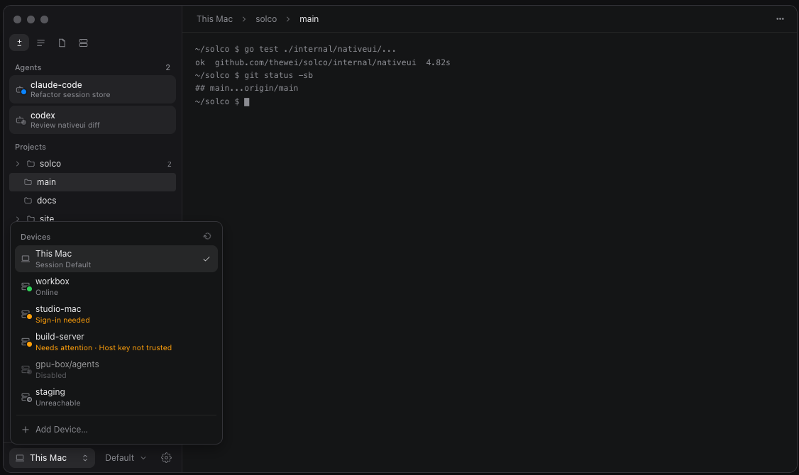
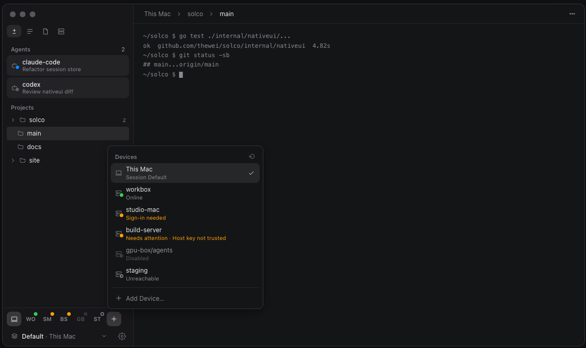
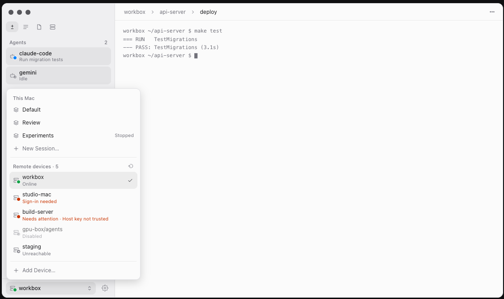
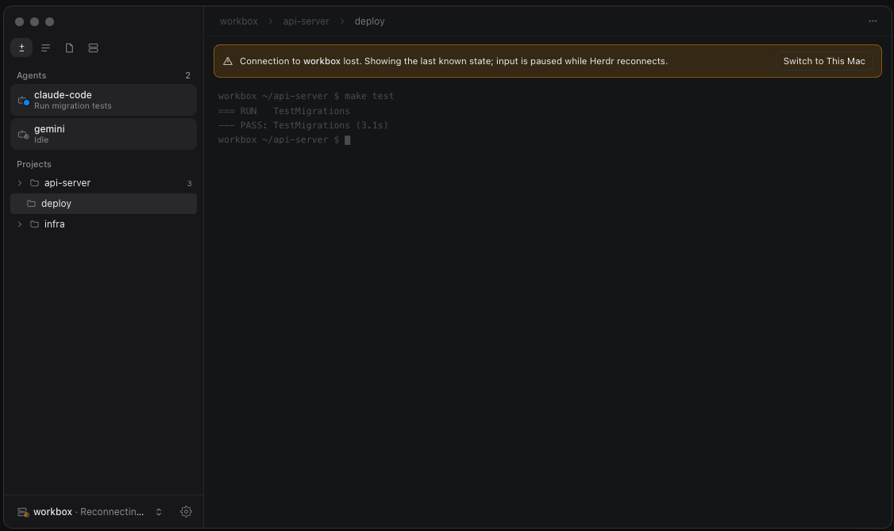
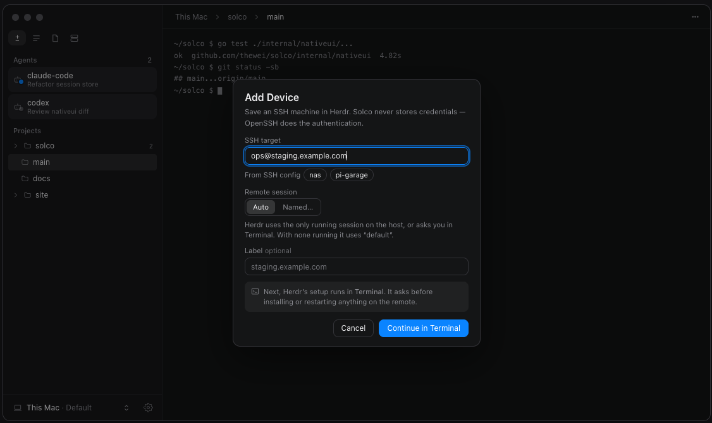
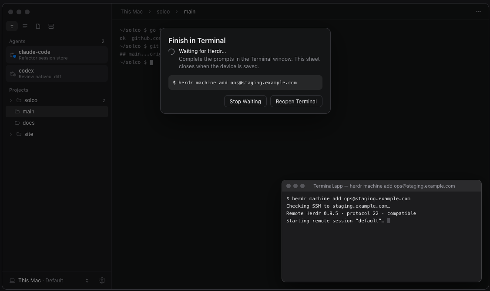
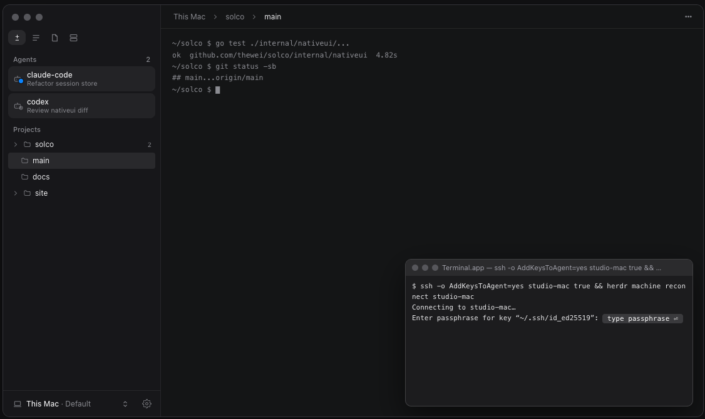
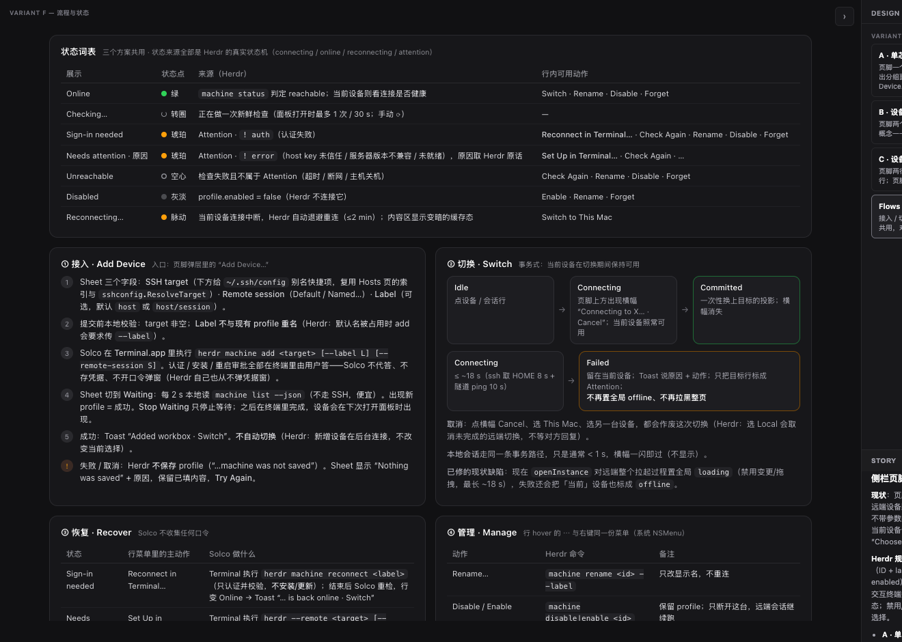
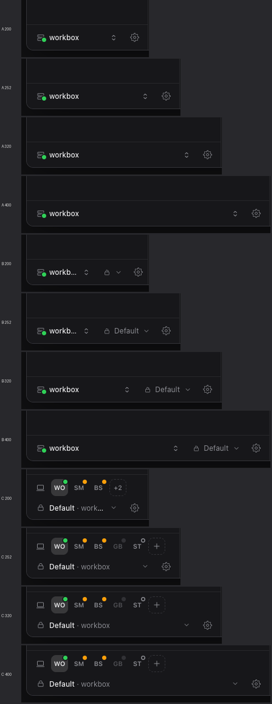

# Design Brief: 侧栏底部 · 设备切换 / 会话切换

> 工作流：`think` → `interactive-design-exploration`（Phase 0–3；Phase 4 在定稿后）。
> 原型：[`exploration.html`](exploration.html)（自包含，`file://` 直接打开，无构建、无外链）。

---

## Decision

| 字段 | 内容 |
|------|------|
| **Status** | `Approved 2026-10-30` |
| **Chosen** | Option A — 单芯片 + 统一面板 |
| **组合说明** | 无组合。Add Device = Terminal 接力 + 轮询；启动永远先进 This Mac；范围全选（事务式切换 / Reconnect·Set Up·Check Again / Enable·Disable / Command Center 设备切换入口）；**Sign-in 恢复本轮就做 Solco 自有 ControlMaster**（支持 MFA；这是对原建议「AddKeysToAgent + reconnect」的升级，见下方「Phase 4 设计增补」） |
| **实现授权** | 是 — 实施并用 Computer Use 实机验证 |

---

## Problem

侧栏最下方现在只有一个 `Session: Default ▾`（系统 NSMenu）+ Settings 齿轮。Herdr 的远程设备（saved SSH machine）被塞进这个菜单的 "Machines" 分区，只有文字后缀状态，没有"安全切换"，也没有恢复/管理路径。

要决定两件事：

1. 设备与会话怎样在 42pt 的页脚里呈现（方案 A / B / C）；
2. 设备的 **接入 / 切换 / 恢复 / 管理** 流程怎么走——必须贴着 Herdr 真实的远程设备模型。

---

## Phase 0 — 项目调研摘要

### 现状（代码）

| 项 | 发现 |
|----|------|
| 页脚 | `sidebar.go` 的 `foot(...)`：`ui.Row.Height(42).Padding(5,8).Gap(6)` + 顶部 hairline；内容 = `sessionSelector(c)`（`session_selector.go`，单个芯片 → 系统 NSMenu）+ Settings 齿轮 |
| 设备在哪 | NSMenu 的 "Machines" 分区；状态只是文字后缀（`machineMenuSuffix`），每次开菜单时按 30 s 节流刷新（`machineStatusRetryWindow`） |
| 接入 | `addRemoteMachine(target)` → `Manager.OpenMachineAddInTerminal`：写 `$TMPDIR/solco-machine-add-<pid>.command` → `open -a Terminal`；**不传** `--label` / `--remote-session`；无结果回报，20 s 后盲刷新一次 |
| 切换 | `Shell.openInstance` 置**全局** `s.loading=true` 直到 bridge 起来（≤ ~18 s：`remoteHome` 8 s + ping 10 s），期间 mutation / 拖拽 / 窗口动作全被禁；失败走 `updateInstanceError` → `s.offline=true`「Herdr unavailable」——**即使当前设备完好无损** |
| 删除当前设备 | `forgetMachine` 忘记正在查看的设备后停在空白 "Choose a Session" |
| 启动 | `SessionSettings.Instance` 持久化 `activeInstance`，`restoreSession` 当启动提示 → 可能一启动就连远程 |
| Bridge | `internal/herdr/bridge.go`：`ssh -N -o BatchMode=yes -o ExitOnForwardFailure=yes -o ServerAliveInterval=15 -o ServerAliveCountMax=3 -L <local.sock>:<remote sock> <target>`；`remoteHome` 同为 BatchMode；10 s ping 截止；socket 在 `~/.solco/ssh-bridges` |
| 现成可复用 | `switcherChip` + `ui.Popover` + `crumbItemRow` + `switcherSearch`（`sidebar_switchers.go` / `breadcrumb_switcher.go`）、`openTextDialog` / `openConfirm`（`dialogs.go`）、`registerHostMachine` + `sshconfig.ResolveTarget`（`hosts_actions.go`）、`herdr.ListMachines` / `MachineStates`（已带宽松 JSON 解码）、`statusDot`、`tipped` |
| 本机实测 | Herdr 0.9.5；`herdr machine list --json` → `[]`（本机没有已存设备，所以 `machine status --json` 真实形状还没见过——见脆弱假设 #2） |

### Herdr 远程设备接入模型（官方 *Connecting machines*，Herdr 0.9.5）

**Profile = 不透明 ID + label + SSH target + 一个显式远程 session + enabled。** 不存口令 / 私钥 / control socket，认证全留给 OpenSSH。

| 目的 | 命令 |
|------|------|
| 接入 | `herdr machine add <target> [--label L] [--remote-session S]`（要装/替换远端时必须交互终端；失败或取消 → "…; machine was not saved"，什么都不存） |
| 读列表（本地，便宜） | `herdr machine list [--json]` |
| 新鲜检查（非交互 SSH） | `herdr machine status [<label-or-id>] [--json]` |
| 认证恢复（终端里） | `herdr machine reconnect <label-or-id>`（只认证 + 校验，**不安装/更新**） |
| 其余 setup 问题 | `herdr --remote <target> [--session S]` |
| 管理 | `machine rename <id> --label` · `disable` · `enable` · `remove` |
| 远程自动化 | `herdr --machine <label-or-id> <api cmd>` |

文档里直接决定设计的语义（原话 → Solco 行为）：

| Herdr 说 | Solco 照做 |
|----------|-----------|
| "Local opens immediately on startup without waiting for SSH connections." | 启动永远先进 This Mac，不再受持久化的 `activeInstance` 影响 |
| "Selecting Local also cancels an unfinished remote switch." | 切换进行中点 This Mac / 另一台 / Cancel，都只是取消，不等远端回复 |
| "When a connection is lost, the last … state remains visible but dimmed … Input … stay disabled … Reconnecting never takes selection away." | 丢连接：内容变暗 + 暂停输入 + 条幅「Switch to This Mac」；绝不自动改选 |
| "Removing or disabling the machine you are viewing returns you to Local." | Forget / Disable 当前设备 → 回 This Mac（不再停在空白页） |
| "Added … machines … connect in the background without changing your selection." | Add 成功只出 Toast「Added X · Switch」，不自动切 |
| "Background connections never answer prompts or install, update, restart…" | Solco 同样不代答、不存凭据；所有交互在 Terminal 里 |
| "A machine profile targets one remote session." | 远程设备在会话芯片里只显示它钉住的那一个；要另一个 session = 再添加一次（`Add Another Session on X…`） |
| "If the default name is already taken, machine add asks you to pass --label." | Add 表单本地先查重名，行内报错，不等终端失败 |
| 默认 label = `host`，带 session 时 `host/session` | 表单 placeholder 实时显示默认 label |
| Attention：`! auth` = 认证失败，`! error` = 其它 | 行状态拆成 Sign-in needed / Needs attention · 原因，主动作不同 |
| 不带 `--remote-session` 时终端里自动探测：只有一个运行会话就选它，多个让你选，没有则 `default` | 表单的 Remote session 叫 **Auto**（不是 "Default"），并说明这一行为 |

### 约束

- **必须保留**：Herdr 是设备 profile 的唯一权威（Solco 不建第二份设备注册表）；不 `--takeover`；控件只走 `controls.go`、tooltip 只走 `tipped(...)`、菜单仍是系统 `NSMenu`；方案 A / B 页脚高度不变（42pt）。
- **必须对齐**：现有 token（Heading16 / Body12 / BodySmall11、Radius Row8 / Card10、Control 24/28/31、侧栏 `#17171a` / 浅色 `#efeff1`）；MyGo Popover 面板（1px Border + radius 10 + MinWidth(anchor)）；焦点环保持 MyGo 自带。
- **非目标**：Solco 自有 ControlMaster（需要 MFA / 一次性口令的主机本轮不支持，见脆弱假设 #1）；Command Center 里的设备入口（可选，另议）；Hosts 页改版（只对齐文案并复用同一入口）；任何 Herdr 协议新增。
- **预计落点**（Phase 4 开工前再复核代码）：`internal/herdr/machines.go`（enable/disable/reconnect/status 的 argv 与解析）、`internal/herdr/bridge.go`（不改行为）、`internal/nativeui/session_selector.go` → 页脚芯片与面板、`sidebar.go`（单点替换）、`runtime.go`（事务式切换，替掉全局 loading 路径）、`machines.go`、`session.go`（启动忽略远程提示）、新增 `device_*.go`、`sidebar_test.go` 等测试、`internal/nativeui/CLAUDE.md` 与 `docs/client-product-architecture.md`。

---

## Options explored

三个页脚方案共用同一套数据、流程与状态词表（见下文），只在**页脚怎么摆、面板怎么开**上结构不同。

| ID | 名称 | 核心差异 | 优点 | 缺点 |
|----|------|----------|------|------|
| **A**（推荐） | 单芯片 + 统一面板 | 页脚仍是**一个**芯片（当前设备 · 会话，带状态点）；点开向上弹**一个**面板：This Mac（会话列表 + New Session…）／Remote devices（每行状态 + ⋯）／Add Device… | 高度 +0；两次点击完成任何切换；是现有芯片的自然升级；设备只有 1 个钉住的会话，不浪费控件；≥10 项出搜索 | 页脚只看得到"当前"，其它设备状态要开面板才见 |
| **B** | 设备｜会话 双芯片 | 页脚并排**两个**芯片：设备芯片（弹设备面板）＋ 会话芯片（弹当前设备的会话面板） | 概念分离，对应 Herdr 的"设备 → 会话"层级 | 默认 252 宽时设备名就被截断（`workb…`，实测）；远程设备只有 1 个会话，第二个芯片对它基本是摆设；200 宽时会话芯片只剩图标 |
| **C** | 设备轨 + 会话行 | 页脚变**两行**（+36pt）：上行是设备瓦片轨（This Mac + 每台设备的缩写瓦片 + 状态点 + `+N` 溢出），下行是会话行 + 齿轮 | 所有设备状态一眼可见；≤5 台一键直切 | 为低频功能永久多占 36pt；缩写 WO / SM / BS 有歧义；与「minimal · navigation-first」相悖，单设备用户白占高度 |

### 展示方式（逐个说明）

- **A**：`[ ⌸ This Mac · Default ⌃⌄ ] [⚙]`。远程时变成 `[ ⌸● workbox ⌃⌄ ]`（会话钉住，不再重复显示）。点开面板：上半是 This Mac 的会话，下半是 `Remote devices · N`（每行两行文字：名称 / 状态，右侧 hover 出 `⋯`，当前项打勾），底部固定 `Add Device…`；面板右上角有"检查设备"刷新钮。
- **B**：`[ ⌸ This Mac ⌃⌄ ] [ Default ⌄ ] [⚙]`。设备面板 = "Devices"（This Mac + 远程设备）；会话面板在 This Mac 上列全部会话 + New Session…，在远程设备上只显示钉住的会话 + `Add Another Session on X…`。
- **C**：`[💻][WO●][SM●][BS●][GB][ST][+]` 一行瓦片 + `Default · workbox ⌄ [⚙]` 一行。瓦片点一下直切；`+N` 或 `+` 打开完整列表（含 Add / 管理）；hover 瓦片出 tooltip（设备名 + 状态）。

### 交互状态（原型右侧 Scenario / Appearance 控件）

| 状态 | 如何触发（原型内） | 预期行为 |
|------|-------------------|----------|
| Single device | Scenario → Single device | 只有 This Mac；面板里 Remote devices 区只有一句引导 + Add Device… |
| Typical | Scenario → Typical | 3 会话 + 5 台设备（Online / Sign-in needed / Needs attention / Disabled / Unreachable） |
| On a remote device | Scenario → On a remote device | 页脚显示 workbox；面包屑与内容为远程态 |
| Connection lost | Scenario → Connection lost | 内容变暗、输入暂停、条幅 + `Switch to This Mac`；芯片副标题 `Reconnecting…` |
| Many devices | Scenario → Many devices | 12 台：A 出搜索框；C 出 `+N` 溢出瓦片 |
| Add 的三种结局 | Simulate "Add Device" → Succeeds / Needs approval / SSH fails | 直接成功 / 终端里要答 `[y/N]` / SSH 认证失败 → 错误页可 Try Again 且保留已填值 |
| 主题 / 宽度 | Appearance → Dark / Light；200 / 252 / 320 / 400 | 见 `preview-widths.png` |

---

## 共享流程（四个方案通用；原型 Flows 页有完整图）

**① 接入 Add Device** — 入口：面板底部 `Add Device…`（Hosts 页复用同一入口）。

1. Sheet 三个字段：SSH target（下方给 `~/.ssh/config` 别名快捷项，复用 Hosts 页索引与 `sshconfig.ResolveTarget`）· Remote session（Auto / Named…）· Label（可选）。
2. 本地先校验：target 为空、Named 却没填名、label 与已有设备重名 → 行内报错，不进终端。
3. Solco 在 **Terminal.app** 里跑 `herdr machine add <target> [--label L] [--remote-session S]`；认证 / 安装 / 重启的审批都在终端里由用户答——Solco 不代答、不存凭据、不弹口令框。
4. Sheet 进入 *Waiting for Herdr…*：每 2 s 读一次 `herdr machine list --json`（本地、不走 SSH）；profile 出现 = 成功。脚本把**退出码**（只有数字，不含输出）写到 Solco 自己的临时 marker 文件，用来区分"失败/取消"并显示原因；`Stop Waiting` 随时可退。
5. 成功：Toast「Added X · Switch」，**不自动切换**；失败：显示 Herdr 的原话（如 "machine was not saved"）+ `Try Again`（保留已填值）。

**② 切换 Switch**（事务式）：`Idle → Connecting（条幅 "Connecting to X… Cancel"，当前设备原样可用）→ Committed | Failed`。

- 切到 This Mac 立即提交；切到远程才有 Connecting（上限 ≈ 18 s：`remoteHome` 8 s + ping 10 s）。
- Cancel / 选 This Mac / 选另一台 = 取消，迟到的 bridge 结果按 generation 丢弃。
- **失败不改当前设备**：只出 Toast（原因 + 下一步动作：Reconnect… / Set Up… / Check Again），**不**置全局 `offline` / `loading`——这是对现有缺陷的直接修复。

**③ 恢复 Recover**（Solco 不收集任何口令）

| 状态 | 行菜单主动作 | Solco 做什么 |
|------|--------------|--------------|
| Sign-in needed | Reconnect in Terminal… | Terminal 依次跑 `ssh -o AddKeysToAgent=yes <target> true && herdr machine reconnect <label>`：前一步让口令密钥进 ssh-agent（Solco 的非交互 bridge 只认 agent），后一步让 Herdr 认证并校验；结束后重检，行变 Online → Toast「… is back online · Switch」 |
| Needs attention | Set Up in Terminal… | Terminal 跑 `herdr --remote <target> [--session S]`（host key 信任 / 服务器升级在这里审批） |
| Unreachable | Check Again | 重跑 `herdr machine status <id>`；仍失败则保持，不骚扰 |
| Disabled | Enable | `herdr machine enable <id>` → Checking… → 回到真实状态 |

**④ 管理 Manage** — 行 hover 的 `⋯` / 右键（系统 `NSMenu`）：Switch to X · Reconnect… · Set Up… · Check Again ｜ Rename… · Disable / Enable · Forget…（确认框）。Forget / Disable 当前设备 → 回 This Mac。

**⑤ 生命周期**：启动永远 This Mac；状态检查只在**面板打开时**触发（30 s 节流 + 手动刷新钮），不常驻轮询；丢连接 = 暗态 + 暂停输入 + 条幅，Herdr 自己重连，**永不抢选择**。

### 状态词表

| 状态 | 点 | 来源（Herdr） | 行内可用动作 |
|------|----|---------------|--------------|
| Online | 绿 | `machine status` 判定 reachable | Switch · Rename · Disable · Forget |
| Checking… | 转圈 | 正在做一次新鲜检查 | — |
| Sign-in needed | 橙 | Attention · `! auth` | Reconnect in Terminal… · Check Again · Rename · Disable · Forget |
| Needs attention · 原因 | 橙 | Attention · `! error`（host key / 服务器版本不兼容 / 未就绪） | Set Up in Terminal… · Check Again · … |
| Unreachable | 空心 | 检查失败但不是 Attention | Check Again · Rename · Disable · Forget |
| Disabled | 灰 | `enabled = false` | Enable · Rename · Forget |
| Reconnecting… | 脉动 | 当前设备连接中断，Herdr 自动重连（≤ 2 min 退避） | Switch to This Mac |

---

## 待你拍板

| # | 问题 | 选项（★ = 建议） |
|---|------|------------------|
| 1 | 页脚方案 | ★ **A** · B · C · 组合（例：A 的面板 + C 的 `+N` 溢出思路） |
| 2 | Add Device 的交互方式 | ★ **Terminal 接力 + 轮询**（Herdr 文档就叫你"在交互终端里跑"，Solco 零凭据；缺点：要切到 Terminal 窗口）· 应用内**先非交互尝试**、需要审批时再退到 Terminal（体验更顺，但要识别"需要审批"这一类失败，脆弱） |
| 3 | 启动落点 | ★ **永远 This Mac**（与 Herdr 一致）· 恢复上次的远程设备（现状，已知会"启动即卡远程"） |
| 4 | 本轮范围 | ★ Reconnect / Set Up / Check Again + Enable / Disable + 事务式切换 + 失败不污染当前设备 · 另加 Command Center 的设备切换入口（建议下一轮） |
| 5 | 实现授权 | 选定后明确回「可以实施」我才动产品代码 |

---

## 最脆弱假设 / 风险

1. **「Reconnect」只能保证 Herdr 自己的连接，不保证 Solco 的 bridge。** 实测默认 `remote.manage_ssh_config = true`：Herdr 走**自己生成的 ssh 配置 + 私有 per-attach control socket** 复用首次认证；Solco 的 `ssh -L` bridge 是独立的非交互（`BatchMode=yes`）连接，复用不到。
   - 缓解（本轮）：恢复脚本先 `ssh -o AddKeysToAgent=yes …`（口令密钥进 ssh-agent，两边都受益）再 `machine reconnect`；**切换时 bridge 的实际结果为最终裁决**——仍失败就把该行置回 Sign-in needed，并附 `ssh-add` 提示，而不是循环让用户 Reconnect。
   - 已知边界：需要 MFA / 一次性口令的主机，Solco bridge 本轮不支持（正解是 Solco 自有 ControlMaster，复用 OpenSSH 成熟多路复用，属下一轮）。行内如实写明。
   - Phase 4 第一步用真机夹具验证这条链路；证伪则退回"仅提示 `ssh-add`"并更新本节。
2. **`machine status --json` 的真实形状没见过**（本机无已存设备）。现有 `decodeMachineStates` 已是宽松解码，且"无法识别 = 未知，绝不判为不可达"；Phase 4 第一步在夹具里抓真实输出固化进 testdata，再定 `auth` / `error` 的分类依据。
3. **Terminal 接力看不到终端的输出**：成功靠 `machine list` 出现，失败靠 marker 文件里的退出码；终端被用户手动关掉 = 无 marker，Sheet 只能停在 Waiting（提供 `Stop Waiting`）。
4. **一个 profile = 一个钉住的 session**（Herdr 语义）：远程设备上没有"会话切换"，只有"再添加一个 session"。若用户期待在远程设备上像本机一样切 session，需要另议。
5. 原型的状态、耗时、终端输出均为模拟；真实时序以 Phase 4 的 Computer Use 实机验证为准。

---

## Preview

默认直接双击或拖入浏览器打开 `designs/sidebar-footer-switcher/exploration.html`（`file://`）。无需静态服务器。

| 文件 | 打开方式 | 看什么 |
|------|----------|--------|
| `exploration.html` | `file://…/designs/sidebar-footer-switcher/exploration.html` | 右侧栏切 A / B / C / Flows；Scenario、主题、侧栏宽度、Add 结局；Esc 逐层关浮层 |

### 截图

| 状态 | 文件 |
|------|------|
| A · 单芯片 + 统一面板 |  |
| B · 设备｜会话 双芯片 |  |
| C · 设备轨 + 会话行 |  |
| 浅色（A） |  |
| 连接丢失 |  |
| Add Device 表单 |  |
| Add 的终端接力 |  |
| Sign-in 恢复 |  |
| Flows 页 |  |
| 宽度 200/252/320/400 × A/B/C |  |

### 原型自检（可复现）

```sh
agent-browser open "file://$PWD/designs/sidebar-footer-switcher/exploration.html"
agent-browser eval "$(cat designs/sidebar-footer-switcher/smoke.js)"   # 后台启动，约 90 s
agent-browser eval "window.__smokeText"                                # 轮询到非 null
```

结果：81 项断言全 PASS、0 个 JS 报错（A / B / C 各 25 项：弹出、事务式切换、失败不污染当前、取消、回 This Mac、Forget/Disable 当前回本机、Enable、三种 Add 结局、重名拦截、Reconnect；另含 Many 搜索/溢出、Lost、Flows）。

---

## Success criteria（定稿前）

- [x] 原型内可切换全部方案 / 状态
- [x] 默认可在 `file://` 下打开（无静态服务器）
- [x] 视觉与项目 token 一致（色值 / 字号 / 圆角 / 控件高度均取自 `theme.go` 与 MyGo Popover 面板）
- [x] 流程与 Herdr 文档语义逐条对应（见上表）
- [x] 用户已在 `interactive_feedback` 中选定方案
- [x] README Decision 表已更新

---

## Implementation handoff（Phase 4，定稿后填；以下为计划）

| 项 | 内容 |
|----|------|
| 步骤 → 验证点 | ① herdr 层纯函数（argv 构造、`.command` 脚本与 marker、状态分类）→ `go test ./internal/herdr`<br>② 事务式切换状态机（success / fail / cancel / Local 取消 / 迟到结果丢弃；失败不置 `offline`/`loading`）→ `go test ./internal/nativeui -run Switch`<br>③ 页脚芯片 + 面板 + 行 + ⋯ 菜单（替换 `sessionSelector`；改 `sidebar_test.go` 里 "Choose Session" 断言）<br>④ Add Device sheet + 终端接力 + 轮询<br>⑤ Recover / Manage / Forget 当前回本机 / 启动忽略远程提示<br>⑥ 文档：`internal/nativeui/CLAUDE.md`、`docs/client-product-architecture.md` |
| 改动文件 | 见「预计落点」；不新增 settings 键；不改 Herdr 协议 |
| 验证命令 | `GOTOOLCHAIN=auto go test ./...` · `GOTOOLCHAIN=auto go tool mygo vet .` · `GOTOOLCHAIN=auto go tool mygo build` · `git diff --check` |
| 实机验证（Computer Use） | 隔离实例（临时 `HOME` + 专用 `HERDR_SOCKET_PATH`，**不碰用户正在用的 Solco**）；远程夹具 = 用户级 `sshd` 监听 `127.0.0.1:<高位端口>`（临时 host key / authorized_keys、口令密钥 + 临时 ssh-agent），远程用独立命名 session，目标写 `ssh://$USER@127.0.0.1:<port>`，不动用户真实 `~/.ssh/config` 与默认 session。清单：页脚呈现（无设备/有设备）→ 切换成功 → 切换失败（当前不受影响）→ 取消 → Add（Terminal 接力）→ Reconnect → Forget/Disable 当前回本机 → 连接丢失暗态 → 浅/深色与 200/400 宽；每步截图留证，逐条记 PASS/FAIL |
| 回滚 | 无持久化新增；回滚 = 还原新增 `device_*.go` 并把 `sidebar.go` 单点调用改回 `sessionSelector` |
| 与原型差异（如有） | 见下方「Phase 4 设计增补」 |

---

## Phase 4 设计增补（实施中确定的、原型里没有的部分）

1. **Sign-in 恢复 = Solco 自有 OpenSSH ControlMaster**（`internal/herdr/sshcontrol.go`）。在用户自己的 Terminal 里起一条 `ControlPath=~/.solco/ssh-ctl/<目标哈希 12 位>`、`ControlPersist=10m` 的共享连接，口令/MFA 提示全部留在 Terminal，Solco 不收集、不存任何凭据；Solco 自己拨号只用 `ControlMaster=no` 复用，从不自建主连接。
2. **桥接同时转发 API socket 与 `<stem>-client.sock`**。`herdr terminal attach` 从 API socket 路径推出同目录的 client socket；只转发 API 时远端会话能列出却无法 attach（实机验证中发现并修复）。
3. **别名原样交给 Herdr**。Herdr 生成的 ssh 配置 `Include` 用户的 `~/.ssh/config`，Port/IdentityFile/ProxyJump 随别名生效；Hosts 页的「注册机器」不再用 `ssh -G` 压平成 `user@host`，而是预填 Add Device 面板（`sshconfig.ResolveTarget` 因此没有生产调用方，已按用户决定连同 `TestResolveTarget` 一并删除）。
4. **Check Devices = 真连一次**（静默）：Herdr `machine status` 与 Solco 自己的 `ConnectMachine` 并行，**以 Solco 的结果为准**，结果只落在状态行，不弹 toast；转圈期间钮不可重复点。Enable 之后行保持 “Not checked”，直到面板节流刷新或点 Check Devices。
5. **点击停用的设备只解释不拨号**（toast 指向 Enable）；Command Center 同理不列停用设备，在用且应答的设备不列，掉线的在用设备列作重连入口。
6. **桥接生命周期**：切走后保留（快速回切），退出 App 时统一关闭；**Disable/Forget 在窗口离开该设备之后关闭它的桥**（`herdr.CloseBridge`；先收桥会让还在看它的 watcher 误报掉线）。Forget/Disable 当前设备先回 This Mac。
7. **掉线**：watcher 对远程实例首次订阅失败即标记掉线（页面变暗并拦截指针、横幅给恢复动作），重试 600 ms 起翻倍封顶 30 s，首次成功回读新投影并自动恢复。
8. **Add 面板表单**：错误只在草稿未变时显示（编辑即撤销旧错误）；失败保留已填值（Try Again）；成功只出 toast「Added X · Switch」，不自动切换。
9. **宽度两端（实机验证中发现并修复）**：最窄 200pt 侧栏上芯片两段文字按比例收缩，`This Mac` 被截成 `This M…`——现在会话先让位、本机名保持完整（`TestDeviceChipKeepsThisMacWholeOnTheNarrowestSidebar`）；最宽 400pt 侧栏上 MyGo 的 Popover 至少与锚点（芯片）同宽，固定 300pt 的行在面板右侧留出约 40pt 空槽——现在面板内容宽度随芯片宽度撑满（`TestDevicePanelRowsFillAChipWiderThanThePanel`）。两条都做过变异检查（撤掉修复即失败）。
10. **`machine status` 退出码 ≠ 失败**：Herdr 0.9.5 在任一档案出错时退出码为 1，但仍在 stdout 打印全部判定。原先的包装（切换器之前就有）把 stdout 连同退出码一起丢掉，面板的后台刷新会因为一台坏设备而丢光所有设备的状态；现在有判定就照单全收，无判定时错误带 CLI 的 stderr（`TestMachineStatusKeepsTheVerdictsOfAnExitingCLI`，变异检查复现了实机的空消息日志）。

### 实机验证记录（隔离实例：临时 `HOME` + 专用 socket；夹具 = 127.0.0.1:22222 的用户级 sshd + 别名 `sfx-local`；未碰用户正在用的 Solco）

| 项 | 结果 |
|----|------|
| Add 面板：校验 / 别名快捷项 / Terminal 接力 + 轮询 / Waiting + Stop Waiting | PASS |
| 切换成功（远端终端可 attach）/ 失败不污染当前设备 / 取消 / 启动永远先进 This Mac | PASS |
| Sign In（Solco ControlMaster，口令由 askpass 夹具代答）→ 重新检查转绿 | PASS（Terminal 步骤由 `open` 垫片模拟：Cursor Computer Use 不驱动 Terminal） |
| 掉线横幅与自动恢复 / Connecting 横幅 + Cancel | PASS |
| 面板状态点与词表 / Check Devices / 行 ⋯ 与右键菜单内容 / Rename / Disable / Enable | PASS |
| Forget：确认框 Cancel 保留档案 / 停用行解释 toast / **Forget 在用设备 → 回 This Mac 且桥接进程与 socket 被收走** / Forget 后用同别名重新 Add | PASS |
| Command Center Devices 条目 | PASS |
| 浅色（带设备行）/ 最窄 200pt 与最宽 400pt 侧栏的芯片与面板（面板在页脚芯片处向上弹出） | PASS（修复上面第 9 条两处缺陷后复测） |
| Hosts 页行菜单「Add Herdr Machine…」→ Add 面板预填 `sfx-local`（别名未被压平） | PASS |
| server 类失败（停掉远端 Herdr server 后切换）：Connecting 横幅约 10 s → 日志 `kind=server` → 行变红点 “Needs setup” → toast 带 Set Up 动作 | PASS（Set Up 接力本身没有真跑：它会让 Herdr 在远端安装/升级自己，不适合在夹具上真跑；脚本构造与退出码 marker 由 `terminal_task_test.go` 覆盖，行菜单随状态给出 Set Up… 由 `TestDeviceRowMenuOffersTheRecoveryTheStateAsksFor` 覆盖） |

实机部分的驱动：Cursor Computer Use 后端在后半程整体超时（`computer_check_permissions` 正常、应用级调用 15 s 超时），改用项目文档化的 `cua-driver` CLI（`.agents/skills/solco-ui-audit/SKILL.md`）。
